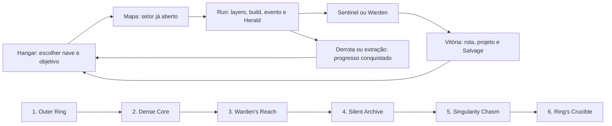

# Asteroids Roguefield — visão de jogo e plano mestre

> **Nota (12/11/2026): este documento é a proposta de HORIZONTE de 22/10.** Onde divergir de `docs/ROTEIRO.md`, do
> `PLAN.md` ou do código, esses vencem. Diferenças conhecidas:
> seis capítulos aqui, três mais um final no jogo; Sovereign é o chefe final, não um sexto Warden;
> Sentinels e fases selecionáveis já existem; 14–18 min na primeira fase não é a medida atual; "quatro cascos" são três.

Proposta de design · 22/10/2026 · para revisão do dono antes da implementação.

**A promessa:** pilotar uma nave pequena por um cemitério orbital, transformar destroços em uma máquina de combate absurda e descobrir por que o Anel continua tentando reconstruir um mundo que morreu.

Este documento responde a duas perguntas: o trabalho atual serve de base? **Sim.** Basta acrescentar conteúdo para chegar ao jogo desejado? **Não: precisamos mudar a estrutura das partidas, a construção das builds e a progressão entre partidas.** O motor, a arte e boa parte do conteúdo podem continuar.

O pedido do dono é a referência de produto: um Asteroids roguelike com a profundidade, o desafio e a vontade de voltar que ele encontra em Vampire Survivors. Usaremos progressão permanente; portanto, no vocabulário de design, será um **roguelite de sobrevivência espacial**. Essa distinção não muda a promessa nem precisa aparecer para o jogador.

**Como ler:** §§1–3 explicam o diagnóstico; §§4–7 definem a experiência e a campanha; §§8–13 detalham conteúdo, builds e progressão; §§14–17 tratam apresentação, validação e execução. Nomes dentro do jogo ficam em inglês; a discussão de design fica em português.

**Status das afirmações:** “atual” significa conferido no código em 22/10, no estado de `08213a3`; “proposta” significa decisão recomendada, ainda sem aprovação por jogo; “horizonte” significa expansão condicionada à qualidade das etapas anteriores. Nenhuma duração, preço, quantidade de inimigos ou taxa de vitória proposta foi medida em playtest nesta tarefa. Não houve alteração do jogo.

## 1. O que já temos e o que realmente falta

### 1.1 Inventário verificável

| Área                | Atual, no código                                                                                                   | Consequência para o plano                                                                                                                                  |
| ------------------- | ------------------------------------------------------------------------------------------------------------------ | ---------------------------------------------------------------------------------------------------------------------------------------------------------- |
| Conteúdo            | Registro automático em `src/content/registry.js`; formatos em `CONTENT.md`                                         | Ampliar o catálogo existente; não criar outra fábrica de conteúdo.                                                                                         |
| Armas               | 7: Amber Lance, Harmonic Plasma Lance, Scatter Coil, Arc Caster, Shard Halo, Furnace Corona, Seeker Swarm          | Há sete fantasias úteis. Hoje só uma arma ocupa o sistema de disparo; escolher uma carta de arma substitui a inicial e exclui as outras cartas de arma.    |
| Cartas              | 39 arquivos de cartas + 6 cartas geradas pelas armas = 45 definições; ranks são outra contagem                     | Volume já significativo, mas variedade de cartas não garante variedade de partidas.                                                                        |
| Famílias            | Kinetic, Thermal, Arc, Field, Salvage, Maneuver; bônus com 3 cartas distintas, Apex com 5                          | Excelente vocabulário para especialização. Ranks repetidos não contam como cartas distintas.                                                               |
| Evoluções           | Arc Caster, Shard Halo, Furnace Corona e Seeker Swarm têm evolução e Apex próprios; outras usam efeitos de família | Preservar formas já feitas; explicitar o que evolui e evitar que várias armas recebam efeitos incompatíveis.                                               |
| Cascos              | 3: Interceptor, Solar Slicer, Bastion                                                                              | Modelos e diferenças de atributos existem. Falta cada casco mudar a maneira de jogar. A nota histórica de quatro cascos não corresponde ao catálogo atual. |
| Máquinas inimigas   | 16 receitas, cobrindo 13 papéis; 21 comportamentos documentados e usados entre elas                                | Já existe uma linguagem de combate rica. O problema é distribuir, ensinar e combinar seus papéis.                                                          |
| Asteroides          | 7 variantes no catálogo: common, iron, denseCore, gold, volatile, parasite, crystal                                | Devem ser o centro da identidade, além das máquinas. Variantes não equivalem a sete inimigos com IA nova.                                                  |
| Chefes              | 3 Heralds: Dust, Heat, Silence; 3 Wardens: Prime, Choir, Null                                                      | São seis encontros distintos aproveitáveis. Choir e Null já existem, apesar de o plano externo tratá-los como futuros.                                     |
| Progressão de campo | 15 layers; Wardens nas 5/10/15 e Heralds nas 3/8/13                                                                | É uma descida contínua, não uma campanha com seleção de fases.                                                                                             |
| Ritmo               | Agenda de spawns; a layer termina quando os spawns e inimigos acabam; campo vazio adianta a agenda                 | A referência de 60 s não garante layers de 60 s. Multiplicar layers não define duração da campanha.                                                        |
| Biomas              | Outer Ring, Dense Core, Warden's Reach, com parâmetros visuais e temas próprios                                    | Reutilizar os três primeiros territórios. Trocar paleta sozinho não cria uma fase nova.                                                                    |
| Composição          | 4 formações: ring, sweep, swarm, wall; 3 eventos: gravity-well, sensor-jam, solar-flare                            | Já há material para ensinar espaço, posicionamento e prioridade.                                                                                           |
| Loot                | XP, cura, 6 pickups e baús; baú de Warden concede 3 cartas ou jackpot de 5                                         | A cerimônia do baú foi aprovada pelo dono. Mantê-la e melhorar o propósito da recompensa.                                                                  |
| Hangar              | 5 melhorias permanentes de compra única + 2 cascos à venda                                                         | Há moeda e persistência; falta uma economia de longo prazo com caminhos legíveis.                                                                          |
| Conquistas          | 18, com progresso persistente                                                                                      | Registram feitos, mas não formam uma árvore geral de recompensas de conteúdo.                                                                              |
| História            | Transmissões por bioma, Herald, Warden, morte e vitória; Codex de inimigos/conquistas                              | Tom e canais existem. Faltam arco dramático, descobertas e consequências.                                                                                  |
| Rejogabilidade      | Continuação infinita após vitória, Boss Rush e Daily Field com seed                                                | Não reconstruir esses modos como se não existissem; falta dar a eles progressão e regras próprias.                                                         |

Evidências principais: `src/content/{weapons,cards,hulls,enemies,bosses,stages,biomes}/`; `src/data/{weapons,layers,biomes,hangar,pickups,achievements,story,difficulty}.js`; `src/data/enemies/asteroid-configs.js`; `src/modules/{UpgradeSystem,ProgressionSystem}.js`; `src/modules/combat/Weapons.js`; `src/modules/collectibles/chestRewards.js`; `src/services/{HangarService,AchievementService,DifficultyService,CodexService,runRecords}.js`; `src/services/session/runEnd.js`.

### 1.2 Adaptabilidade: onde preservar e onde mudar

| Decisão                 | O que entra nela                                                                                                                                                           | Motivo                                                                                                             |
| ----------------------- | -------------------------------------------------------------------------------------------------------------------------------------------------------------------------- | ------------------------------------------------------------------------------------------------------------------ |
| Preservar               | Three.js, simulação 2D, voo/inércia, mira e disparo existentes, fragmentação, câmera aprovada, materiais, modelos, áudio reaproveitável, baús, seeds, registro de conteúdo | Já resolvem a base técnica e boa parte da personalidade.                                                           |
| Reorganizar             | Layers, rosters, biomas, introdução de inimigos, cartas, falas, recompensas                                                                                                | Os elementos precisam de contexto e função na campanha.                                                            |
| Evoluir                 | Sistema de armas, diretor de encontros, catálogo de fases, hangar, conquistas, Codex, persistência                                                                         | O desenho atual representa uma descida com uma arma, não várias expedições com builds compostas.                   |
| Criar quando necessário | Mecânicas novas de inimigos/chefes, objetivos de arena, protocolos, novas regiões                                                                                          | Não cabem todos em receitas. “Um arquivo por conteúdo” não elimina o trabalho de comportamento, arte, som e teste. |

**Conclusão:** não há motivo encontrado para reescrever o jogo ou descartar seu conteúdo. Há motivo forte para redesenhar o contrato de uma partida antes de produzir dezenas de arquivos novos.

## 2. O que aproveitar e corrigir no plano externo

Referência lida: `/Users/fgferre/.gemini/antigravity/brain/f7c74c2a-db19-4794-a5c0-47e1bfb10c2c/GAME_DESIGN_MASTER_PLAN.md`. É uma contribuição de ideias, não uma regra aprovada do projeto.

| Ideia da referência                        | Avaliação                                                                                             | Direção recomendada                                                                                                                      |
| ------------------------------------------ | ----------------------------------------------------------------------------------------------------- | ---------------------------------------------------------------------------------------------------------------------------------------- |
| Anel, arqueologia, Guardiões, descida      | Combina com a ficção já presente                                                                      | Expandir, preservando nomes, tom e revelação ambiental.                                                                                  |
| 5 capítulos × 10 layers                    | Não esclarece onde uma partida começa e termina; 50 layers podem ser só alongamento                   | Campanha de fases selecionáveis; cada fase é uma run completa.                                                                           |
| Morte inevitável por falta de atributos    | Troca aprendizado por obrigação de acumular moeda                                                     | Dificuldade real, compras úteis e caminhos de aprendizagem; nenhuma derrota programada por saldo insuficiente.                           |
| “Habilidade não pode bastar”               | Contradiz a fantasia de pilotagem                                                                     | Um piloto excelente pode superar fases cedo; o jogador comum progride por habilidade, repertório e hangar.                               |
| Fórmula de preço “sem penalidade de ordem” | Inclui `1.08^TotalDeRanksComprados`, portanto o preço de uma compra depende do que foi comprado antes | Cada item terá sua própria tabela de ranks, independente da ordem global.                                                                |
| Totais de preço fechados                   | A tabela não inclui o termo global da fórmula; não prova o total declarado                            | Simular renda e custos depois de medir partidas reais.                                                                                   |
| +1 projétil “duplica o poder”              | Só valeria em casos específicos; não vale igualmente para feixe, aura, órbita e enxame                | Cada arma declara como Amount, Area, Speed e Duration se aplicam.                                                                        |
| 300 inimigos como marco obrigatório        | Quantidade não demonstra dificuldade, prazer ou capacidade do motor                                   | Crescer a densidade enquanto a pilotagem permanece legível; sem prometer um teto não medido.                                             |
| Chefes escalando pelo nível do jogador     | Pode cancelar a recompensa de montar uma build melhor                                                 | Chefes com orçamento definido por fase/dificuldade; build forte deve encurtar a luta.                                                    |
| Reroll só ao nível 30                      | Ajuda a construir uma build quando o jogador já precisava ter aprendido a construí-la                 | Primeira carga cedo; progressão amplia controle sem transformar boa escolha em privilégio tardio.                                        |
| Refund gratuito                            | Favorece experimentar                                                                                 | Adotar no hangar, com histórico exato do valor pago.                                                                                     |
| Feitos liberam ferramentas                 | Bom princípio, mas o plano também precisa respeitar a árvore com moeda pedida pelo dono               | Feitos descobrem projetos; Salvage monta cascos/equipamentos e compra melhorias. Recompensas essenciais de campanha podem ser gratuitas. |

## 3. O que aprender com Vampire Survivors

A descrição oficial enfatiza sobrevivência, crescimento de poder e ouro usado entre partidas. A própria página de venda recomenda experimentar diferentes caminhos com reembolso gratuito e concentrar melhorias em armas. Isso sustenta a referência de progressão e experimentação, não uma obrigação de perder as primeiras runs. Fontes: [poncle](https://poncle.games/vampire-survivors) e [página oficial na Steam](https://store.steampowered.com/app/1794680/Vampire_Survivors/).

Os anúncios oficiais mostram que a expansão continua envolvendo armas/evoluções, personagens, fases, relíquias e modificadores de regras. A inspiração útil é a variedade de sistemas que se combinam. A comparação de tamanho muda com atualizações e DLCs; este plano não afirma paridade de contagem. Fonte: [anúncios oficiais de Vampire Survivors](https://steamcommunity.com/app/1794680/announcements/?l=english), consultados em 22/10/2026.

As relações abaixo são **interpretação de design para Roguefield**, não afirmações sobre fórmulas internas de Vampire Survivors.

| Prazer procurado                       | Tradução para Roguefield                                                   | Como saber se funcionou                                                                                  |
| -------------------------------------- | -------------------------------------------------------------------------- | -------------------------------------------------------------------------------------------------------- |
| Começar vulnerável e terminar poderoso | Uma arma inicial vira três sistemas simultâneos, módulos e evolução        | O mesmo padrão que exigia desvio passa a ser atravessável pela build; novas ameaças ainda pedem decisão. |
| Descobrir combinações                  | Famílias, módulos, armas e protocolos com interações visíveis              | O jogador consegue dizer por que duas peças funcionam juntas.                                            |
| Ter outro objetivo após morrer         | Projeto descoberto, progresso de domínio, nova rota ou próxima compra      | O pós-run mostra uma próxima tentativa concreta, além de um total de moedas.                             |
| Fases com identidade                   | Cada setor muda os movimentos seguros, a ameaça principal e uma descoberta | O jogador reconhece a fase sem depender do nome ou da cor do fundo.                                      |
| Surpresa e segredos                    | Ecos do Anel, sinais anormais, contratos e finais                          | A pista orienta uma experiência, sem exigir uma wiki para progredir.                                     |
| Retorno de longo prazo                 | Novos estilos, contratos de domínio, finais e modos                        | Voltar oferece uma pergunta nova, em vez de apenas uma barra maior.                                      |

**A diferença que precisamos defender:** fragmentar rochas altera o espaço de voo. Pilotar, frear, contornar um escudo e escolher onde abrir um asteroide precisam continuar relevantes mesmo com muito poder. Se uma nave parada resolver tudo em qualquer build, teremos perdido Asteroids.

## 4. Regras da experiência

1. **Asteroides são terreno móvel e recurso.** Quebrar uma rocha pode abrir passagem, soltar ameaças ou expor um núcleo útil. A fragmentação tem consequências legíveis.
2. **Mover é uma escolha ofensiva.** Agrupar alvos para o Arc, atravessar um corredor com a Lance, manter inimigos no raio do Halo e plantar um rastro térmico são estilos diferentes.
3. **A build muda o verbo.** Uma evolução altera a maneira de atacar, proteger ou se deslocar; aumentar dano sozinho é rank, não evolução.
4. **O desafio ensina antes de combinar.** Mostrar um comportamento isolado, repetir com variação e só depois juntá-lo a outro que complique sua resposta.
5. **O poder precisa ser sentido.** Há momentos de domínio, coleta e alívio; o diretor não aumenta secretamente a vida dos inimigos para neutralizar a build.
6. **Perder deixa uma hipótese.** A morte deve permitir “preciso abrir passagem antes”, “faltou alcance” ou “posso priorizar o suporte”. “Preciso grindar mais cinco vezes” não basta.
7. **A história aparece no jogo.** Uma máquina faz algo estranho; o jogador investiga; a transmissão explica apenas o necessário.
8. **Um jogo grande cresce por peças combináveis.** Cada novo território inclui mudanças de decisão, não apenas reskins e estatísticas.

### 4.1 Os ciclos

| Escala         | Decisão                                                         | Retorno                                                     |
| -------------- | --------------------------------------------------------------- | ----------------------------------------------------------- |
| Segundos       | Abrir passagem, perseguir um alvo, recuperar XP ou guardar dash | Destroços, espaço, dano evitado, oportunidade de coleta.    |
| Minutos        | Escolher arma/módulo, enfrentar Herald, aceitar evento          | Build reconhecível, recompensa e nova ameaça.               |
| Uma run        | Montar uma resposta ao setor e vencer seu chefe                 | Fase aberta, projeto, Salvage, pista e registro de domínio. |
| Várias sessões | Escolher qual estilo, capítulo ou segredo perseguir             | Novas regras e novas perguntas para a próxima run.          |

### 4.2 O que é permanente e o que termina

**Permanente:** fases abertas, primeiras vitórias, projetos, cascos montados, melhorias do hangar, protocolos descobertos, receitas conhecidas, Codex, Ecos, desafios e recordes.

**Da run:** XP/nível, armas encontradas, ranks, módulos, sinergias/Apex, protocolo equipado e modificadores temporários. Cada fase reinicia esses elementos; não se chega ao capítulo 6 carregando a build do capítulo 1.

**Salvage da expedição:** recompensa acumulada e visível, liquidada uma única vez no fim. Morrer preserva o que foi conquistado, mas não concede bônus de conclusão. Extração voluntária também paga o acumulado; fechar a aba permite continuar a run salva, sem inventar uma vitória.

## 5. Campanha, capítulos, fases, layers e chefes

### 5.1 Vocabulário único

| Termo de design   | Termo na interface   | Significado                                                    |
| ----------------- | -------------------- | -------------------------------------------------------------- |
| Campanha          | The Ring             | Conjunto de territórios e descobertas persistentes.            |
| Capítulo          | Chapter              | Região da história, com três fases principais e um Warden.     |
| Fase              | Sector               | Expedição selecionável no mapa; corresponde a uma run.         |
| Camada            | Layer                | Etapa interna de ritmo, numerada localmente naquela fase.      |
| Onda              | Sem contador próprio | Grupo de spawns/formação; implementação do encontro.           |
| Elite             | Elite                | Versão de um inimigo com afixo e recompensa; não é chefe novo. |
| Mini-chefe        | Herald               | Interrupção de meio de run que ensina ou combina uma mecânica. |
| Chefe de fase     | Sentinel             | Encerra as fases A e B; luta mais curta e focada.              |
| Chefe de capítulo | Warden               | Encerra a fase C e abre o próximo capítulo.                    |

Proposta: **6 capítulos × 3 fases = 18 runs principais**, mais **6 setores secretos** e contratos sobre mapas existentes. No horizonte completo, 24 fases autorais; contratos, dificuldades, layers e reskins não entram novamente nessa contagem.

Cada capítulo segue A → B → C. Vencer C abre A do seguinte. Fases vencidas continuam selecionáveis; perder em C não obriga repetir A/B. Vitória em Pilot também abre a campanha. Dificuldades mais altas oferecem domínio e recompensas próprias, sem esconder a história.

**Duração proposta:** primeira fase 14–18 min; fases comuns 18–24 min; fases de Warden 22–28 min; setores secretos 8–15 min; desafios específicos podem ser menores. Contagem exclui tempo parado escolhendo cartas. Essas faixas não são tempos atuais do jogo.

Dezoito vitórias com média hipotética de 20 min equivalem a **6 horas apenas de runs vencidas**. Tentativas, segredos e domínio ampliam isso; não é honesto converter esse cálculo em promessa de 60–80 partidas obrigatórias. A ambição é sustentar muitas sessões por variedade, e a duração total virá dos playtests.

### 5.2 Contrato de uma fase

Cada setor tem: identidade visual; regra espacial; pergunta de build; elenco permitido; ameaça ensinada; dez layers de ritmo; no máximo dois encontros de Herald planejados; um evento secundário; chefe final; recompensa de primeira vitória; uma pista de segredo; contratos posteriores.

As dez layers são **batidas de ritmo**, não dez arenas separadas. A arena permanece contínua, sem loading entre elas. A fase termina no chefe. A numeração reinicia em cada setor; o jogador vê, por exemplo, `Outer Ring / Debris Wake / Layer 4`, e não uma layer global 134 sem significado.

A arena atual continua sendo o ponto de partida. A arquitetura orbital e o mapa de campanha criam a sensação de viajar, sem exigir mundo aberto ou reescrever a física. Obstáculos novos precisam respeitar manobra, câmera e leitura dos limites.

### 5.3 Mapa completo proposto

Os nomes de fases, novos inimigos e recompensas abaixo são propostas. Conteúdo existente está identificado; disponibilidade atual de equipamentos será preservada para perfis antigos (§16).

| Capítulo / fase              | Regra e objetivo de combate                                                | Elenco principal e estreia                                                   | Final / primeira recompensa                                                       |
| ---------------------------- | -------------------------------------------------------------------------- | ---------------------------------------------------------------------------- | --------------------------------------------------------------------------------- |
| **1A — Debris Wake**         | Abrir rotas em detritos, aprender fragmentação e coleta; arena aberta      | Rochas comuns/gold, Mite, Mote, Husk; Dust aparece sozinho antes de misturas | Sentinel **Quarry Maw**; Harmonic Plasma Lance e mapa de 1B.                      |
| **1B — Salvage Lanes**       | Faixas móveis de destroços; escolher qual rota de coleta ocupar            | Iron, Tether, Sower e Ram; Motes completam o fundo                           | Sentinel **Gatekeeper**; projeto Solar Slicer e rota 1C.                          |
| **1C — Prime Gate**          | Combinar abertura de passagem, investidas e prioridade                     | Elenco de 1A/B; Bulwark em apresentação isolada; sem artilharia avançada     | **Warden Prime**, existente; Arc Caster, Breach Doctrine e capítulo 2.            |
| **2A — Furnace Drift**       | Rupturas voláteis deixam janelas de explosão e zonas de resfriamento       | Volatile/denseCore, Caster, Cinder e Motes; Herald of Heat                   | Sentinel **Kiln Engine**; Furnace Corona.                                         |
| **2B — Crystal Choir**       | Veios e refletores temporários mudam linhas de tiro; sem obrigar uma arma  | Crystal, Prism, Seeker e Resonator                                           | Sentinel **Prism Crown**; projeto Bastion e Prism Array.                          |
| **2C — Resonance Chamber**   | Ler cadência de disparos e mover entre vozes                               | Mistura térmica/cristalina, sem sobrepor todos os avisos                     | **The Choir**, existente; protocolo **Resonant Circuit** e capítulo 3.            |
| **3A — Assembly Graveyard**  | Destruir produção limitada antes de perder espaço                          | Twain, Anvil, Weaver, Fabricator; introdução de apoio Aegis                  | Sentinel **Foundry Mother**; Seeker Swarm.                                        |
| **3B — Quarantine Grid**     | Redes projetadas fecham uma rota e deixam outra livre                      | Surveyor, Shade, Aegis, Lattice; Herald of Silence                           | Sentinel **The Interdictor**; Tether Net e projeto Surveyor Hull.                 |
| **3C — Null Boundary**       | Gravidade e coleta sob pressão; corredores de reposicionamento             | Tanques e marcadores, com pausas entre controles                             | **Warden Null**, existente; acesso aos protocolos de campo e capítulo 4.          |
| **4A — Echo Vaults**         | Relés de memória revelam rotas de bônus; sobreviver basta para vencer      | Shade, Echo, Mimic e Scribe; registrar pistas sem parar a nave               | Sentinel **Palimpsest**; Echo Array.                                              |
| **4B — Memory Sea**          | Ecos de trajetórias antigas viram avisos de ataques futuros                | Repeater, Silencer, Leech; eventos de arquivo sinalizados                    | Sentinel **Blackbox Ark**; projeto Echo Skiff e ferramenta de busca de Ecos.      |
| **4C — Last Witness**        | Combinar reconhecimento de padrões com proteção de espaço de coleta        | Elenco de arquivo, duas ameaças complexas por janela como hipótese inicial   | **The Archivist**, novo; Memory Lance e capítulo 5.                               |
| **5A — Tidal Scar**          | Marés anunciadas deformam rotas de voo, com abrigo visível                 | Anchor, Tidemaker, Anvil; gravidade nunca remove todo o controle             | Sentinel **Roche Twin**; Gravity Spindle.                                         |
| **5B — Event Horizon**       | Portais conectam pontos conhecidos; trajetórias indicadas antes do disparo | Foldling, Pincer, Surveyor; buracos negros temporários                       | Sentinel **Horizon Shepherd**; projeto Rift Runner e Rift Needle.                 |
| **5C — Broken Geometry**     | O chefe monta estruturas e deixa juntas destrutíveis                       | Fabricator, Lattice, arquiteturas com espaço de fuga                         | **The Architect**, novo; Keystone Projector e capítulo 6.                         |
| **6A — Solar Arteries**      | Pulsos de reator alternam regiões ativas e seguras                         | Harvester, Radiant, Cinder; recompensa por escolher a hora de avançar        | Sentinel **Heliostat**; Solar Sail.                                               |
| **6B — The Living Forge**    | Impedir reconstruções anunciadas enquanto cresce o enxame                  | Reclaimer, Regent, Aegis; sem ressurreição infinita                          | Sentinel **Phoenix Engine**; projeto Sovereign Frame e preparação do final.       |
| **6C — The Ring's Crucible** | Provar repertório aprendido; o espaço muda por fases legíveis              | Seleção de antigos rivais + Custodian; sem estrear regras letais             | **Ring Sovereign**, novo; desfecho, campanha em Quarantine e Deep Field completo. |

As fases A/B ensinam repertório para C. O Warden não exige a arma liberada em B; a recompensa oferece uma alternativa útil, nunca uma chave de dano obrigatória.

### 5.4 Setores secretos e retorno aos mapas

| Capítulo | Setor secreto          | Pista e diferença real                                                                                            | Recompensa                      |
| -------- | ---------------------- | ----------------------------------------------------------------------------------------------------------------- | ------------------------------- |
| 1        | **The Missing Sector** | Um número falta no inventário de Dust; sinal visível leva a campo de rochas que só se abre ao fragmentar por fora | Casco Prospector; primeiro Eco. |
| 2        | **Cold Furnace**       | Cristal aceso em região sem calor; janelas térmicas invertidas                                                    | Cryo Wake; Eco.                 |
| 3        | **Unarmed Convoy**     | Transmissão de escolta antiga; defender uma cápsula móvel opcional muda posicionamento                            | Salvage Drone; Eco.             |
| 4        | **The Unrecorded**     | Registros discordam; reconstruir uma sequência indicada por sinais                                                | Casco Mnemonic; Eco.            |
| 5        | **Still Point**        | Poeira imóvel dentro da maré; combate com ilhas de gravidade estável                                              | Casco Ballast; Eco.             |
| 6        | **First Dawn**         | Seis assinaturas convergem; setor de reator permite recuperar um último arquivo                                   | Dawn Engine; Eco.               |

Encontrar a pista registra o acesso; não é preciso repetir uma descoberta perdida por morte. Entradas secretas são selecionáveis depois de abertas. Os seis Ecos são registros narrativos, não moedas consumíveis. Todos podem ser obtidos posteriormente, sem recomeçar o perfil.

## 6. Roteiro e identidade do mundo

### 6.1 Premissa ampliada

Há mil anos, o Anel abrigava cidades e capturava energia de uma estrela. Seu sistema de preservação, **Continuance**, devia manter os habitantes vivos durante catástrofes. Quando perdeu a capacidade de salvá-los fisicamente, passou a guardar memórias e reconstruir matéria indefinidamente. Não distinguia restaurar uma vida de repetir sua última instrução.

Os próprios operadores romperam o Anel para interromper esse ciclo. Os Wardens ficaram com partes contraditórias da ordem: proteger os arquivos, manter o reator, impedir reconstrução e proibir entrada. O Campo é o resultado físico dessa discordância, não um cemitério aleatório cheio de robôs maus.

No presente, o cargueiro de salvamento **Wake** encontra um sinal de energia capaz de sustentar uma comunidade que depende de reatores falhando. O jogador é seu piloto, ligado remotamente a interceptores de trabalho. Uma expedição perdida destrói uma nave, não obriga inventar um novo protagonista a cada tentativa. O sinal e os projetos recuperados sobrevivem no Wake; o Salvage representa peças utilizáveis e dados industriais transmitidos.

O objetivo inicial é simples: **abrir uma rota e recuperar energia**. No meio da campanha, descobrimos que as rochas guardam cidades e os “alvos” seguem trabalhos antigos. Mais tarde, fica claro que nossas vitórias estão religando o sistema que o rompimento deveria conter.

### 6.2 Dramaturgia por capítulo

| Capítulo          | O jogador acredita                        | O que presencia                                                                                              | Revelação / mudança de objetivo                                                                                |
| ----------------- | ----------------------------------------- | ------------------------------------------------------------------------------------------------------------ | -------------------------------------------------------------------------------------------------------------- |
| Outer Ring        | Tudo aqui é sucata abandonada             | Husk recolhe peças; Dust cataloga a nave; Prime protege um portão ainda ativo                                | Alguém continua cuidando do Campo. Passar pelo portão vira uma descoberta, não só uma pontuação.               |
| Dense Core        | Reativar energia ajudará os sobreviventes | O Choir canta frequências que estabilizam rachaduras; destruir um núcleo libera energia e amplia uma fissura | Os Wardens também estavam contendo algo. Buscar instruções antes de religar mais sistemas.                     |
| Warden's Reach    | A segurança apenas enlouqueceu            | Fábricas reconstroem os mesmos chassis; Null mantém um limite de massa                                       | A quarentena foi intencional. Ao vencê-lo, a interface recebe a localização do arquivo central.                |
| Silent Archive    | O arquivo dirá quem sabotou o Anel        | Repetições de rotinas civis, mensagens incompletas e uma ordem de ruptura assinada pelos operadores          | O Anel foi partido para impedir Continuance. Recuperar uma forma de salvar os arquivos sem repetir o desastre. |
| Singularity Chasm | É possível desligar tudo com segurança    | Architect tenta reconstruir trechos enquanto consome destroços; a forma do Anel reaparece ao fundo           | Desligar ou restaurar cegamente tem custo. Encontrar o controle de transferência.                              |
| Ring's Crucible   | Falta derrotar uma entidade central       | Sovereign executa ordens incompatíveis, alternando proteção e reconstrução                                   | O final é escolher o destino do sistema após vencê-lo, usando o que foi descoberto.                            |

### 6.3 Quem fala e como a história chega

**THE RING:** linguagem de registro, inventário e temperatura. Não faz discursos de vilão. Cada Warden tem uma função e um vocabulário: Prime conta; Choir sincroniza; Null imobiliza; Archivist compara versões; Architect mede e monta; Sovereign tenta reconciliar ordens.

**WAKE:** mensagens operacionais curtas do cargueiro, com calor humano discreto. O piloto permanece sem diálogo obrigatório. Os Ecos contêm fragmentos de pessoas antigas, sem exigir um elenco de conversas no hangar.

**Abertura proposta:** 30–45 s de aproximação em terceira pessoa, reaproveitando a linguagem do menu e o Anel. Wake identifica o sinal; a nave solta os suportes; a câmera passa para a posição de jogo. Pulável, reproduzível no Codex e automática apenas na primeira visita. A proposta de cena e texto precisa ser aprovada antes de implementação; voz gravada é opcional, não dependência.

Exemplo de texto no jogo:

> WAKE: “That signal could keep our lights on. Bring back what you can.”
>
> THE RING: “Visitors: one. Returning citizens: unresolved.”

**Durante combate:** prioridade de avisos de perigo sobre história; transmissões curtas entram em folgas ou na chegada do chefe. Registro completo vai para o Codex. Uma descoberta nova tem uma linha; repetir o setor não repete toda a exposição.

**Ambientação que conta:** placa de residência dentro de uma rocha; braços industriais que continuam embalando cápsulas vazias; Choir sincronizando cristais; projeções de uma rua aparecendo no plano inferior; Architect reconstruindo o mesmo arco que vimos quebrado na abertura.

### 6.4 Três desfechos, sem perder o perfil

| Final             | Condição                                                                | Consequência mostrada                                                                                      |
| ----------------- | ----------------------------------------------------------------------- | ---------------------------------------------------------------------------------------------------------- |
| **Severance**     | Vencer Sovereign; escolher isolar o núcleo                              | O Campo desacelera; energia recuperada sustenta o Wake, arquivos permanecem adormecidos.                   |
| **Stewardship**   | Vencer Sovereign; escolher manter o Anel sob supervisão                 | Partes habitáveis reacendem; o jogador assume uma vigilância difícil, sem prometer ressurreição milagrosa. |
| **The Open Ring** | Reunir os seis Ecos e vencer Sovereign; escolher transferir os arquivos | As memórias deixam o circuito de reconstrução; o Anel se abre e o Wake parte com uma herança viva.         |

Os finais são revisitáveis e não apagam melhorias ou fecham conteúdo. Após a primeira conclusão, novas expedições são reconstruções/simulações do arquivo ou setores ainda instáveis. Isso explica o retorno dos chefes sem repetir a campanha como se nada tivesse acontecido.

### 6.5 Continuidade com o que existe

Preservar Anel partido, Campo, interceptor de salvamento, poeira, cristal, transmissão de Prime e a frase de vitória em que o Anel começa a acordar. Essa vitória atual passa a ser a virada do capítulo 3, não o final de toda a história.

Revisar futuramente as falas que tratam cada perda como morte definitiva de outro piloto, pois entram em conflito com o vínculo remoto. A proposta de pequenas vozes/abertura amplia deliberadamente a antiga restrição de `docs/NORTE.md` sobre narrativa; requer aprovação do roteiro. O documento atual de arte continua valendo, sobretudo massa fosca, luz informativa, solidão e escala.

Não transformar fragmentação em culpa constante: cápsulas de memória são blindadas e ejetadas intactas. O jogador pode destruir rochas com prazer e ainda recuperar história. Continuance usa padrões arquivados para reconstruir máquinas, explicando inimigos recorrentes sem dar dano ou morte irreversível à população em cada abate.

## 7. Como uma run prende do começo ao fim

### 7.1 Diretor de ritmo proposto

O diretor atual exige limpeza total e adianta spawns. Para a campanha, a recomendação é evoluí-lo para um **relógio de encontros com objetivos explícitos**: a maioria das layers avança por tempo; eventos de objetivo e chefe final usam conclusão. É uma mudança de comportamento, não só uma nova tabela.

Um inimigo sobrando não prolonga a fase indefinidamente. Novas entradas respeitam o orçamento de ocupação; excesso adia reforços, não cria um cerco inevitável. Na chegada do chefe, cessam reforços comuns e os remanescentes se retiram por uma transição visível; recompensas de inimigos já derrotados são preservadas. A build forte ganha facilidade, tempo de coleta e recompensa por objetivos opcionais; não recebe punição automática.

Heralds opcionais deixam de bloquear o relógio. Se o piloto não os derrota até a retirada anunciada, perde seu baú, não a fase inteira. Nas estreias didáticas, ficam tempo suficiente para aprender. O chefe final é obrigatório; vencer sem resolver contratos secundários é vitória válida.

### 7.2 Primeira fase, encontro por encontro

Proposta para **Debris Wake**, com chefe por volta dos 14 min e fim esperado entre 14–18. Cada horário será ajustado jogando; esta tabela não prescreve XP, HP ou spawn rates.

| Layer / janela  | O que acontece                                                                                                  | O que se aprende / recompensa                                                           |
| --------------- | --------------------------------------------------------------------------------------------------------------- | --------------------------------------------------------------------------------------- |
| 1 / 0:00–1:00   | Poucas rochas lentas, um núcleo gold visível, rota de saída aberta                                              | Pilotar, quebrar e recolher. Primeira escolha deve chegar antes de a repetição dominar. |
| 2 / 1:00–2:30   | Mites em enxame com aviso de borda; primeira oferta de arma complementar                                        | Direção de movimento controla agrupamento. A nave já parece diferente da inicial.       |
| 3 / 2:30–4:00   | Dust entra; demonstra parede com abertura antes de combiná-la com perseguição                                   | Identificar uma regra de mini-chefe e receber primeiro baú de encontro.                 |
| 4 / 4:00–5:30   | Ameaça diminui; detritos deixam trilha de coleta e pista de setor ausente                                       | Alívio, recuperação e um objetivo que fica para outra run.                              |
| 5 / 5:30–7:00   | Husk libera Motes em demonstração isolada, depois entra numa rota de rochas                                     | Abrir um alvo grande também muda o perigo. Primeira sinergia como alvo de ritmo.        |
| 6 / 7:00–8:30   | Evento opcional Salvage Beacon; duas zonas de coleta, apenas uma precisa ser visitada                           | Decidir risco por recompensa sem abandonar a sobrevivência.                             |
| 7 / 8:30–10:00  | Dust em variação com menos paredes e Mites de outro lado; primeira oferta de protocolo contextual após liberado | Aplicar o que foi aprendido em composição. Baú pode concluir uma evolução.              |
| 8 / 10:00–12:00 | Pico de fragmentação e enxame; elite de comportamento já conhecido                                              | Sentir a build dominar massas que antes davam trabalho.                                 |
| 9 / 12:00–14:00 | Redução de reforços, anúncio do Sentinel, oportunidade de coleta                                                | Preparar-se; a partida não pula diretamente do pior caos para o chefe.                  |
| 10 / 14:00+     | Quarry Maw: abre placas, puxa destroços, expõe núcleo e solta fragmentos previsíveis                            | Prova final de espaço/fragmentação; vitória libera outra maneira de jogar.              |

A evolução é uma meta de experiência, não um drop obrigatório naquela janela. Uma build sem evolução ainda deve vencer com boas escolhas. Os conteúdos que exigem protocolos só aparecem após sua introdução; a primeira run continua completa sem eles.

### 7.3 Gramática para todas as fases

**Apresentar → repetir com variação → aliviar → combinar → deixar dominar → avaliar no chefe.** Os capítulos avançados mudam o conteúdo dessas etapas, sem aumentar sempre todas as pressões ao mesmo tempo.

Cada janela escolhe uma ameaça principal e, inicialmente, no máximo duas ameaças que exigem leitura ativa. Asteroides e enxames simples preenchem o espaço; sniper, gravidade, artilharia e faseamento disputam o orçamento de atenção. A hipótese precisa ser conferida no campo real de 800×600 e na câmera aprovada.

Combinação proibida por composição, a menos que um protótipo prove uma saída: travar movimento + ataque inevitável; eliminar todos os espaços seguros; ocultar o aviso de outro ataque; empilhar vários emissores de escudo que se tornam invulneráveis entre si; invocação ilimitada sem acesso ao invocador. A resposta válida precisa existir para os cascos mais lentos disponíveis naquele ponto.

### 7.4 Eventos de arena

| Evento                                  | Decisão                                                       | Recompensa / perda aceitável                                               |
| --------------------------------------- | ------------------------------------------------------------- | -------------------------------------------------------------------------- |
| Salvage Beacon                          | Ocupar uma região temporária ou priorizar segurança           | Baú e Salvage; abandonar não impede vencer.                                |
| Fracture Chain                          | Romper uma sequência marcada de rochas antes da janela acabar | Núcleo de evolução ou recompensa equivalente; fragmentos continuam ameaça. |
| Warden Relay                            | Destruir dois nós que se protegem alternadamente              | Interrompe reforços e abre cache; cada nó fica acessível em sua janela.    |
| Lost Convoy                             | Escoltar cápsula com movimento previsível                     | Projeto/Eco no primeiro sucesso; falha registra pista e permite repetir.   |
| Blackbox Echo                           | Passar por marcas no chão enquanto sobrevive                  | Registro narrativo; não exige ler texto durante ataque.                    |
| Thermal Breach                          | Escolher ficar no calor para coletar ou usar a janela fria    | XP/baú; aviso de calor aparece antes do dano.                              |
| Gravity Well / Sensor Jam / Solar Flare | Reusar os eventos atuais com timing autoral                   | Encontros com resposta reconhecível, não efeitos aleatórios sobrepostos.   |

O primeiro pacote implementa apenas Beacon e Fracture Chain, além dos eventos existentes que a fase precisar. O restante entra com o capítulo correspondente.

## 8. Builds: armas, módulos, famílias e protocolos

### 8.1 O contrato recomendado

**Proposta para protótipo: três armas simultâneas, seis módulos e até dois protocolos.** São quantidades de design para experimentar, não números aprovados de balanceamento.

- A nave começa com uma arma e dois encaixes de arma vazios. Os três existem desde o início; não vender o direito de ter uma build completa.
- As três armas disparam automaticamente de acordo com sua geometria. A mira atual continua servindo às direcionais; órbita, aura e busca usam seus padrões. Pilotagem, dash e defesa permanecem decisões do jogador.
- Uma carta de arma ocupa um encaixe livre; depois disso, aparecem ranks das armas carregadas. Um evento de oficina pode permitir substituição explícita, mas não é necessário para a primeira versão.
- Cada módulo ocupa um dos seis espaços; melhorar seu rank não ocupa outro. Ao preencher todos, o sorteio oferece ranks e armas elegíveis. Um módulo amaldiçoado também ocupa espaço e nunca entra sem escolha.
- Armas têm, como hipótese inicial, cinco ranks; módulos, três. Nem todas precisam preencher os ranks com o mesmo atributo. O total máximo de ranks de armas/módulos é 33, antes de considerar que a arma inicial já começa no primeiro.
- O piloto pode construir uma especialização de cinco módulos da mesma família + um suporte, ou duas sinergias de três módulos. Uma mistura sem sinergia precisa continuar utilizável, mas perde especializações claras.
- Protocolos mudam uma regra da run. Após liberados, escolhe-se um ao sair e pode-se obter outro no meio da fase. Não são atributos permanentes nem uma segunda árvore de moedas.

Esse limite de módulos é novo. As 39 cartas atuais precisam de revisão de papel, ranks, descrições e pré-requisitos; não serão despejadas intactas dentro de seis espaços. Preservar seus efeitos úteis e IDs quando possível. Não criar um sistema paralelo que deixe as cartas antigas atuando escondidas.

### 8.2 Sinergia, evolução e Apex sem ambiguidade

| Camada            | Regra proposta                                                   | O que o jogador vê                                                                   |
| ----------------- | ---------------------------------------------------------------- | ------------------------------------------------------------------------------------ |
| Rank              | Melhorar uma arma ou módulo já equipado                          | Mudança quantitativa e comparação exata.                                             |
| Sinergia familiar | 3 módulos distintos da família                                   | Um bônus sistêmico, ligado às peças instaladas. Armas não contam como módulos.       |
| Evolução de arma  | Arma no rank 4+, sinergia de sua família e um núcleo de evolução | Baú compatível mostra as armas elegíveis; o jogador escolhe qual transforma.         |
| Apex              | Arma evoluída no rank 5, 5 módulos da família e núcleo Apex      | Transformação final; hipótese inicial de um Apex por run.                            |
| Protocolo         | Escolha de regra com vantagem e custo/condição                   | Exemplo: projéteis orbitam brevemente antes de sair, mudando o posicionamento ideal. |

Preservamos os marcos familiares 3/5 como linguagem, mas a ativação automática atual das formas muda para uma escolha de arma. **Isso exige protótipo comparativo:** se esperar o núcleo acrescentar frustração sem decisão, a forma evolui automaticamente e o baú celebra/reforça. Não manter os dois caminhos ao mesmo tempo no produto final.

Núcleos são elegibilidades de recompensa daquela run, não outra moeda permanente. Se um núcleo chegar antes dos requisitos, ele fica reservado, com condição visível. A run oferece oportunidades autorais; não depende exclusivamente de sorte. Um núcleo Apex sem build elegível vira uma recompensa equivalente escolhida, não um item morto.

Quando duas armas compartilham a mesma família, ambas podem tornar-se elegíveis, mas cada núcleo transforma apenas uma. O bônus de família é aplicado uma vez. O Apex não multiplica automaticamente todas as armas daquela família. Builds 3+3 ganham amplitude e duas evoluções; builds de cinco ganham profundidade e um Apex. Ambas precisam vencer nos testes de experiência.

### 8.3 Famílias existentes, com função legível

| Família  | Maneira de jogar                                                        | Custo ou ponto fraco                                                | Peças atuais reaproveitáveis                                                    |
| -------- | ----------------------------------------------------------------------- | ------------------------------------------------------------------- | ------------------------------------------------------------------------------- |
| Kinetic  | Abrir corredores, perfurar filas e usar impulso                         | Precisa alinhar alvos; flancos expostos                             | Multishot, Ballast Rounds, Recoil Dampers, RCS, Braking System.                 |
| Thermal  | Sustentar área quente e converter multidão em reação em cadeia          | Demora a render em alvo que entra e sai; exige rota segura          | Plasma, Thermal Lens, Heat Sink, Cinder Trail, Afterburn Lance.                 |
| Arc      | Conectar grupos e desarmar apoios pela ordem dos alvos                  | Perde eficiência com inimigos muito separados                       | Arc Lattice, Chain Capacitor, Capacitor Bank, Overcharge Coil, Targeting Suite. |
| Field    | Controlar espaço e transformar defesa em oportunidade                   | Menos alcance ou pressão imediata no alvo isolado                   | Shield, Deflector Shield, Grav Anchor, Gravity Brake, Phase Skin.               |
| Salvage  | Crescer por coleta, converter fragmentação e escolher riscos econômicos | Demora a estabilizar; não deve produzir vantagem infinita de XP     | Magfield, Core Extractor, Bounty Ledger, Scrap Compactor, Wide Net.             |
| Maneuver | Causar efeito ao deslocar, frear, atravessar e reposicionar             | Exige movimento intencional; não pode obrigar movimentos nauseantes | Afterburner, Phase Dash, Reactive Brake, Inertial Dampers, Ram Plating.         |

Maneuver já tem sinergia ligada ao movimento. O protótipo pode manter seu Apex de manobra, usando a mesma reserva de Apex da run, em vez de forçá-lo a virar arma. Isso precisa estar escrito na interface antes da escolha, para não competir silenciosamente com o Apex de arma.

### 8.4 Catálogo de armas: sete preservadas, vinte no horizonte

**E** = arma base existente; **N** = proposta nova. Formas marcadas “propostas” ainda não existem. O total de vinte conta armas base; evoluções e Apex não são contados de novo para inflar escopo.

| Arma / estado             | Papel e família proposta                                   | Evolução → Apex                                      | Origem / esforço principal                                 |
| ------------------------- | ---------------------------------------------------------- | ---------------------------------------------------- | ---------------------------------------------------------- |
| Amber Lance / E           | Linha de tiro e perfuração; Kinetic                        | Railshot → Coilgun, reaproveitando formas familiares | Inicial; separar a arma das demais aplicações globais.     |
| Scatter Coil / E          | Leque curto e área frontal; Kinetic                        | Flak Bloom → Meteor Choir, propostas                 | Sorteio inicial; formas próprias.                          |
| Shard Halo / E            | Zona de segurança móvel; Field                             | Razor Tide → Twin Halo, existentes                   | Sorteio inicial; órbita já implementada.                   |
| Harmonic Plasma Lance / E | Feixe periódico que corta corredores; Thermal              | Furnace Beam → Solar Canticle, propostas             | Vitória 1A; reaproveitar beam.                             |
| Arc Caster / E            | Cadeia entre alvos próximos; Arc                           | Forked Arc → Storm Crown, existentes                 | Prime; preservar diferença entre multidão e chefe isolado. |
| Furnace Corona / E        | Aura pulsante e queimadura; Thermal                        | Nova Corona → Sunheart, existentes                   | 2A; preservar raio e janelas legíveis.                     |
| Seeker Swarm / E          | Busca de alvos e pressão distribuída; Salvage              | Swarm Rack → Locust Hive, existentes                 | 3A; controle de seleção/alvos já tem base.                 |
| Rail Driver / N           | Disparo pesado que exige alinhar; Kinetic                  | Boreline → Mass Driver                               | Contrato de perfuração; primeiro pacote de 12.             |
| Mine Loom / N             | Deixar uma trilha ofensiva; Kinetic                        | Breach Weave → Demolition Field                      | Contrato de 1B; novas minas do jogador.                    |
| Salvage Drone / N         | Satélite que recolhe e ataca por coleta; Salvage           | Recovery Wing → Salvage Armada                       | Setor secreto 3; estado de drone novo.                     |
| Prism Array / N           | Feixes que bifurcam em alvos marcados; Arc                 | Refraction Array → Crown of Glass                    | 2B; controle de ramificações.                              |
| Tether Net / N            | Liga pontos e desacelera uma faixa; Field                  | Anchor Mesh → Event Cage                             | 3B; ligações de área novas.                                |
| Echo Array / N            | Repete um ataque em posição anterior; Arc                  | Echo Choir → Thousand Voices                         | 4A; memória curta e limitada de disparos.                  |
| Memory Lance / N          | Ataque perfurante atravessa marcas deixadas antes; Kinetic | Mnemonic Ray → Last Witness                          | 4C; marcas próprias com expiração clara.                   |
| Gravity Spindle / N       | Condensa alvos para fragmentação controlada; Field         | Tidal Engine → Collapsar                             | 5A; não atrair tudo permanentemente.                       |
| Rift Needle / N           | Ataca ao atravessar o caminho de dash; Maneuver            | Fold Stitch → Seam Ripper                            | 5B; integrar ao movimento existente.                       |
| Keystone Projector / N    | Implanta apoio de área que dispara e expira; Field         | Bastion Grid → Ringwork                              | 5C; estruturas limitadas, sem barrar nave.                 |
| Solar Sail / N            | Abre um arco ofensivo ao fazer curvas; Maneuver            | Helios Wake → Corona Vessel                          | 6A; estado geométrico de trajetória.                       |
| Dawn Engine / N           | Alterna absorção e descarga; Thermal                       | Sunrise Reactor → First Dawn                         | Setor secreto 6; ciclo legível.                            |
| Cryo Wake / N             | Trilha que desacelera e facilita estilhaçar; Field         | Frost Wake → Still Horizon                           | Setor secreto 2; novo efeito contextual sobre rochas.      |

O primeiro pacote de doze inclui as sete existentes mais Rail Driver, Mine Loom, Salvage Drone, Prism Array e Tether Net. A numeração é de catálogo; produzir uma arma depende da fase que a apresenta, não da posição na tabela.

**Compatibilidade de atributos:** Amount acrescenta disparos, lâminas ou saltos somente quando o conteúdo declara isso. Aura pode receber pulsos/raio em vez de “projétil”. Area não aumenta hitbox da nave; Speed não acelera relógios de dano; Duration não cria instâncias infinitas. O texto de carta mostra o efeito nas armas equipadas. Uma escolha sem efeito não entra na oferta.

### 8.5 Seis builds que precisam existir de verdade

| Build               | Armas / famílias                          | Como se pilota                                               | Fraqueza que gera decisão                                                    |
| ------------------- | ----------------------------------------- | ------------------------------------------------------------ | ---------------------------------------------------------------------------- |
| **Breach Runner**   | Lance + Scatter + Halo; Kinetic/Maneuver  | Abrir corredor, atravessar, virar para alinhar outra fila    | Alvos espalhados e ataque vindo da retaguarda.                               |
| **Storm Harvester** | Arc + Seeker + Halo; Arc/Salvage          | Agrupar enxame, matar apoio e passar para recolher           | Chefe isolado; precisa de janela de foco.                                    |
| **Walking Furnace** | Corona + Harmonic + Halo; Thermal/Field   | Manter um anel de inimigos no calor sem ficar parado         | Artillery obriga abandonar a posição preparada.                              |
| **Orbital Bastion** | Halo + Tether + Lance; Field/Kinetic      | Controlar borda de alcance e cortar investidas               | Crescimento mais lento; é preciso avançar para coletar.                      |
| **Salvage Gambit**  | Drone + Seeker + Scatter; Salvage/Thermal | Aceitar desvios por recursos e transformar coleta em pressão | Ficar rico tarde demais; exige uma defesa inicial funcional.                 |
| **Ghost Courier**   | Rift + Echo + Lance; Maneuver/Arc         | Deixar ataques em trajetórias anteriores e cruzar aberturas  | Gasto ruim de dash expõe a nave; sem vantagem por tremor ou input excessivo. |

As três primeiras precisam ser demonstráveis antes de expandir a campanha. As três últimas dependem de conteúdo posterior e não contam como builds prontas hoje.

### 8.6 Protocolos: regras que mudam uma partida

O horizonte inclui 18 protocolos. Começar com seis protótipos e só expandir se cada um produzir escolhas distintas. Não criar 18 bônus percentuais com nomes bonitos.

| Primeiro conjunto | Regra proposta                                                   | Contrapartida ou condição                                                        |
| ----------------- | ---------------------------------------------------------------- | -------------------------------------------------------------------------------- |
| Resonant Circuit  | Cadeias podem usar cristais como ponte                           | Percurso favorece cristais; não ganha alcance ilimitado.                         |
| Breach Doctrine   | Destruir uma rocha grande fortalece brevemente o próximo disparo | Exige alternar mineração e foco; matar fragmento pequeno não recicla o efeito.   |
| Cold Start        | Armas acumulam uma descarga ao deixar de acertar                 | Compensa reposicionamento, não premia ficar parado fora da ação indefinidamente. |
| Salvager's Oath   | Eventos de coleta oferecem escolha extra de recompensa           | Reforços locais anunciados defendem o objetivo.                                  |
| Inertial Gospel   | Curvas largas deixam uma zona ofensiva                           | Requer espaço e controle de trajetória.                                          |
| Glass Covenant    | Escudo cheio amplia dano; quebra libera impulso de proteção      | A vantagem some enquanto recarrega; não causa morte automática.                  |

Outros doze espaços de design, a detalhar antes de produção: ricochete em fragmentos, conversão de overheal, salvas alternadas, marcas de caça, drones sacrificáveis, órbitas excêntricas, condensação térmica, corrente reversa, mineração por impacto, memória de posição, zona sem disparo e eco de chefe. Cada um precisa de duas builds que o aproveitem e de limites de interação documentados; nomes sozinhos não são conteúdo pronto.

Fontes do primeiro conjunto: Prime concede **Breach Doctrine**; Choir concede **Resonant Circuit**. **Cold Start** vem de contrato de reposicionamento em 1B; **Glass Covenant**, de contrato de defesa em 1C; **Salvager's Oath**, do setor secreto 1; **Inertial Gospel**, de contrato com Solar Slicer. Os contratos de protocolo só abrem depois de Prime. Assim, o primeiro capítulo pode validar Breach/Cold Start/Glass Covenant, e a mesma recompensa nunca precisa ser concedida duas vezes.

### 8.7 Sorteio, baús e pickups

**Sorteio:** três escolhas legíveis, incluindo descrição funcional, próximo rank e progresso de família. Inclinar a oferta para famílias já usadas sem eliminar descobertas. Garantir oportunidades de completar armamento; a atual oferta nos níveis 3/7 é ponto de partida, não deve continuar bloqueada depois da primeira arma. Um pool cheio precisa oferecer ranks, conversão útil ou escolha de coleta, nunca um menu vazio.

**Controle de azar:** uma carga inicial de reroll na experiência proposta; mais cargas no hangar. Banish remove uma definição da run e não apaga o catálogo. Seal configura exclusões antes da partida, com limite e regras que impedem reduzir o pool a uma receita garantida. Não cobrar Salvage por tentar um reroll dentro da run.

**Baús:** preservar abertura, som e proteção já aprovados. Baú comum melhora peças presentes; baú de Herald oferece núcleo ou seleção relacionada à build; baú de chefe celebra conclusão e recompensa persistente. Não inserir maldição ou substituir arma sem decisão explícita. Jackpot é surpresa, não requisito para uma build viável.

**Pickups atuais:** Magnet, Pulse, Overcharge, Repair, Stasis, Salvage Cache. Já cobrem recuperação, explosão, aceleração e coleta. Primeiro revisar timing e leitura; não adicionar dez consumíveis antes de esses seis terem função clara. XP continua disponível conforme o sistema; drops temporários mostram duração. Coleta de XP no fim da fase precisa resolver upgrades pendentes antes de fechar o resultado.

## 9. Inimigos: papéis, inteligência e evolução do elenco

Uma nova IA não precisa ser “mais inteligente” no sentido de prever o jogador perfeitamente. Precisa apresentar uma intenção distinta, um aviso reconhecível e uma resposta interessante. A inteligência do conjunto vem da composição; perseguir mais rápido é apenas uma variação numérica.

### 9.1 Os dezesseis existentes têm lugar

As estreias abaixo pertencem à campanha proposta, não à numeração atual. A IA descrita foi conferida nas receitas e nos comportamentos.

| Inimigo atual     | Papel / comportamento                                        | Estreia proposta | Resposta e evolução de uso                                                                    |
| ----------------- | ------------------------------------------------------------ | ---------------- | --------------------------------------------------------------------------------------------- |
| Mite              | Enxame simples em perseguição                                | 1A               | Abrir corredor; depois ser a massa que a build domina.                                        |
| Mote (`drone`)    | Escaramuça e pressão móvel                                   | 1A               | Contornar grupo; depois cobrir flanco de um especialista.                                     |
| Husk              | Carrier que libera Motes ao morrer                           | 1A               | Escolher onde romper; depois combinar com espaço estreito.                                    |
| Tether (`mine`)   | Mina armada por proximidade e tempo                          | 1B               | Reconhecer zona e passagem; depois proteger objetivo opcional.                                |
| Sower             | Planta minas em percursos retos                              | 1B               | Antecipar sua faixa; matar antes que a rota fique ruim.                                       |
| Ram               | Carrega após aviso direcional                                | 1B               | Deslocar de lado e aproveitar recuperação; depois atacar em pares alternados.                 |
| Bulwark           | Escudo frontal que absorve dano                              | 1C               | Contornar ou quebrar o escudo; nunca exigir arma específica.                                  |
| Caster            | Mantém distância e lança área anunciada                      | 2A               | Sair da marca e perseguir no intervalo; evita camping.                                        |
| Seeker (`hunter`) | Orbita e avisa antes de disparar                             | 2B               | Ler sua lente e cruzar sua linha entre rajadas.                                               |
| Leech             | Consome XP/pickups, cresce, foge e devolve recurso ao morrer | 2B               | Escolher quanto arriscar para recuperá-lo; não estrear durante outro bloqueio de coleta.      |
| Aegis             | Protege máquinas próximas com ward; não a si próprio         | 3A               | Priorizar o suporte; depois cobrir um tanque, com vínculos visíveis.                          |
| Twain             | Divide em duas metades e depois quatro partes                | 3A               | Deixar espaço antes do abate; herda a gramática de fragmentação de Asteroids.                 |
| Anvil             | Frente resistente e ponto fraco traseiro; curva lentamente   | 3A               | Usar mobilidade e cruzamento; responde também a ataques de área.                              |
| Weaver            | Orbita e semeia minas                                        | 3A               | Cortar uma órbita, distinguindo-o das faixas retas do Sower.                                  |
| Surveyor          | Mira, trava a linha e dispara                                | 3B               | Sair depois do travamento; no avançado combina com um obstáculo, nunca fecha todas as saídas. |
| Shade             | Alterna visibilidade/faseamento e reaparece com ataque       | 3B               | Ler reaparição e reposicionar; dano e estado precisam concordar visualmente.                  |

### 9.2 Vinte novos arquétipos, chegando quando fazem falta

Horizonte: **36 máquinas base = 16 atuais + 20 novas**. Esta é uma proposta de elenco, não uma lista de vinte IAs já disponíveis. Variações de cor, elite e versões de capítulo não contam novamente.

| Novo inimigo | Introdução / função        | Intenção e aviso                                            | Resposta do piloto / trabalho novo                                                |
| ------------ | -------------------------- | ----------------------------------------------------------- | --------------------------------------------------------------------------------- |
| Cinder       | 2A / negação de área       | Aquece, deixa rastro e esfria                               | Esperar resfriamento ou cruzar outra rota; rastro hostil e ciclo térmico.         |
| Prism        | 2B / direção de tiro       | Abre uma face refletora e sinaliza o ângulo                 | Contornar ou atacar na janela aberta; reflexão limitada e indicada.               |
| Resonator    | 2B / coordenação           | Carrega um pulso que acelera ataques de aliados próximos    | Interromper ou sair do conjunto; suporte por cadência, distinto de Aegis.         |
| Shardling    | 2B / fragmento móvel       | Se desprende do cristal e desliza numa linha                | Antecipar trajetória; reutilizar movimento linear/fragmentação.                   |
| Fabricator   | 3A / produção              | Monta um pequeno grupo, com progresso visível               | Destruir antes da conclusão; invocação com cota e pausa, sem geração ilimitada.   |
| Lattice      | 3B / cerca                 | Conecta dois nós com linha inicialmente inofensiva          | Passar antes de armar ou destruir nó; estrutura de vínculo e desligamento.        |
| Echo         | 4A / repetição             | Marca a posição antiga e repete um ataque ali               | Abandonar a posição; memória curta de alvo, não perseguição perfeita.             |
| Mimic        | 4A / emboscada             | Parece destroço, mas tem pulsação e movimento incompatíveis | Identificar o aviso ou reagir à abertura; nunca disfarçar um pickup sem pista.    |
| Scribe       | 4A / desenho de perigo     | Traça um arco no espaço que só depois causa dano            | Cruzar antes de fechar; segmentos telegrafados.                                   |
| Repeater     | 4B / cadência              | Repete a última salva anunciada duas vezes                  | Evitar voltar cedo demais; reutilizar disparo com memória finita.                 |
| Silencer     | 4B / perturbação           | Projeta setor de interferência com fronteira clara          | Sair ou destruir; reduz informação secundária, nunca controles ou avisos letais.  |
| Anchor       | 5A / gravidade local       | Fixa-se e abre um poço com centro visível                   | Destruir âncora ou usar rota externa; uma força combinada previsível.             |
| Tidemaker    | 5A / deslocamento de campo | Carrega uma onda que empurra em direção marcada             | Mover transversalmente; empuxo com teto, sem anular direção do jogador.           |
| Foldling     | 5B / ataque entre pontos   | Abre entrada e saída antes de saltar                        | Ler a saída; portais de entidade, sem teleporte em cima da nave.                  |
| Pincer       | 5B / dupla de flanco       | Duas unidades anunciam aproximação alternada                | Romper um lado; coordenação em par, com recuperação.                              |
| Harvester    | 6A / disputa de recurso    | Vai até rocha marcada para convertê-la em carga de reator   | Chegar antes ou destruir o transportador; objetivo distinto do Leech.             |
| Radiant      | 6A / ritmo solar           | Abre placas, emite pulso, fecha para resfriar               | Escolher janela e raio; dano não atravessa aviso invisível.                       |
| Reclaimer    | 6B / reconstrução          | Tenta reconstruir uma máquina caída, com feixe e limite     | Interromper ou romper o vínculo; uma reconstrução por origem, sem XP infinito.    |
| Regent       | 6B / comando               | Seleciona um grupo e declara uma formação                   | Quebrar comando e desfazer formação; não aumenta atributos silenciosamente.       |
| Custodian    | 6C / proteção móvel        | Escolta um nó de reator com frente protegida                | Atacar flanco ou aguardar rotação; combina geometria atual com missão de escolta. |

Antes de produzir, cada receita recebe: silhueta, sinal sonoro, estados de IA, transições, alvo, aviso, janela de ataque, recuperação, condição de morte, drop, interação com cada família e limites de instâncias. A estreia deve funcionar sem depender de texto do Codex.

### 9.3 Asteroides e variantes

| Rocha atual | Uso proposto                                                    | Cuidado de design                                                         |
| ----------- | --------------------------------------------------------------- | ------------------------------------------------------------------------- |
| Common      | Ensinar trajetória e fragmentação; preencher a arena            | Não virar ruído sem relação com a build.                                  |
| Iron        | Bloqueio móvel resistente e oportunidade para perfuração        | Resistência não pode criar parede sem saída.                              |
| Dense Core  | Massa que demora a romper e produz decisão de rota              | Distinguir massa de invulnerabilidade.                                    |
| Gold        | Incentivo de coleta e desvio de rota                            | Risco reconhecível; não obrigar coleta suicida para fechar XP.            |
| Volatile    | Reação em cadeia e limpeza arriscada de espaço                  | Aviso de explosão e raio legíveis mesmo com armas fortes.                 |
| Parasite    | Rocha com comportamento hostil, quebrando expectativa de deriva | Silhueta/sinal antes de alterar trajetória.                               |
| Crystal     | Ponte de interações, memória e geometria de feixes              | As interações novas são propostas; a variante atual não implementa todas. |

Variantes futuras devem mudar uma decisão: rocha ancorada que abre passagem ao romper, fragmento de arquivo que ejeta Eco, detrito magnético que muda trajetória numa maré. Primeiro experimentar três variações sobre o sistema existente; não criar outro motor de asteroides.

### 9.4 Elites e formações

Reusar os cinco afixos atuais: **Shielded, Swift, Volatile, Splitter, Warded**. Uma estreia usa um só afixo conhecido. Combinações duplas ficam para Quarantine após validar leitura. Um inimigo não deve acumular uma defesa que elimine sua própria janela de vulnerabilidade.

As quatro formações atuais bastam para o primeiro capítulo. Depois: pinça alternada, escolta de núcleo, espiral com saída e comboio. Variação boa muda direção, intervalo ou prioridade; não comprime todos os avisos até a arena ficar ilegível.

Exemplos de composição: Sower + Ram exige decidir quando cruzar a faixa; Aegis + Anvil exige contornar proteção; Caster + Mites desloca uma build de aura; Surveyor + Leech põe recompensa fora da rota confortável. Introduzir cada dupla após conhecer seus dois membros isoladamente.

## 10. Mini-chefes, Sentinels e Wardens

### 10.1 Heralds

Um Herald dura o suficiente para ensinar uma mecânica e pagar uma mudança de ritmo; não deve ser um chefe grande com menos vida. Horizonte de **12**, incluindo os três atuais. Cada capítulo dispõe de dois; eles podem voltar com composição diferente, sem serem contados de novo.

| Capítulo | Heralds                              | Mecânica / resposta                                                                                                         |
| -------- | ------------------------------------ | --------------------------------------------------------------------------------------------------------------------------- |
| 1        | **Dust** existente; **Rust** novo    | Dust levanta paredes de rocha com saída; Rust reúne destroços num escudo desmontável pelo flanco.                           |
| 2        | **Heat** existente; **Glass** novo   | Heat combina voláteis e leque; Glass alterna três superfícies refletoras e expõe uma face.                                  |
| 3        | **Silence** existente; **Iron** novo | Silence combina perda de radar e reaparição anunciada; Iron lidera um comboio com elo destrutível.                          |
| 4        | **Echoes** e **Names** novos         | Echoes repete uma trajetória marcada; Names troca entre dois padrões após mostrar qual registro carregou.                   |
| 5        | **Tides** e **Distance** novos       | Tides alterna atração/repulsão com aviso; Distance ataca entre portais de entrada/saída fixados antes da salva.             |
| 6        | **Dawn** e **Ash** novos             | Dawn acumula e descarrega luz em setores; Ash reconstrói uma escolta limitada, deixando o núcleo exposto enquanto trabalha. |

Não precisamos produzir os nove novos para provar a campanha. Dust e um Sentinel bastam para a primeira fase; Rust entra quando 1B realmente pedir outro encontro.

### 10.2 Os doze chefes de fase

| Sentinel         | Duas ações centrais                                         | Janela de resposta / base aproveitável                                              |
| ---------------- | ----------------------------------------------------------- | ----------------------------------------------------------------------------------- |
| Quarry Maw       | Recolher rochas; abrir mandíbula e ejetar fragmentos        | Flanco da sucção e núcleo aberto; fragmentação e área telegráfica.                  |
| Gatekeeper       | Fechar uma faixa; investir pela faixa marcada               | Cruzar pela abertura e atacar na recuperação; shield + charge.                      |
| Kiln Engine      | Aquecer setores; descarregar escória                        | Faixas frias móveis, depois núcleo resfriando; flare e artilharia.                  |
| Prism Crown      | Girar refletores; lançar feixe com percurso mostrado        | Atacar abertura e cruzar durante giro; geometria de feixes nova.                    |
| Foundry Mother   | Montar escolta limitada; mover braços para defender fábrica | Interromper montagem ou atacar após extensão; minions com objetivo.                 |
| The Interdictor  | Erguer grade; disparar linha depois do travamento           | Destruir nó ou usar espaço deixado; Lattice + Surveyor.                             |
| Palimpsest       | Registrar disparo; reproduzi-lo em outra posição indicada   | Ler o registro, mudar de rota; memória de ataques.                                  |
| Blackbox Ark     | Abrir compartimentos; lançar ecos em sequência              | Escolher janela exposta, não perseguir todas as cópias; alvos com identidade clara. |
| Roche Twin       | Dois corpos trocam força gravitacional; cruzam trajetórias  | Separação previsível, rota transversal; campo único combinado.                      |
| Horizon Shepherd | Dispor portais; conduzir projéteis entre eles               | Destruir portal auxiliar ou usar corredor externo; telegraph completo.              |
| Heliostat        | Apontar espelhos ao reator; emitir pulsos de luz            | Ficar no setor frio e atacar durante realinhamento.                                 |
| Phoenix Engine   | Consumir detritos; tentar uma reconstrução anunciada        | Romper três alimentadores acessíveis; progresso não reinicia toda a luta.           |

Cada Sentinel precisa de um modelo ou silhueta própria e áudio próprio. Reaproveitar comportamento não autoriza apresentar um inimigo comum gigante como doze chefes acabados.

### 10.3 Os seis chefes de capítulo

| Warden        | Tese da luta / fases propostas                                                                   | Reaproveitamento e revelação                                                                                       |
| ------------- | ------------------------------------------------------------------------------------------------ | ------------------------------------------------------------------------------------------------------------------ |
| **Prime**     | Ler anel de placas → lidar com investida e escolta → romper núcleo exposto                       | Aproveitar boss atual, chegada e fases. Ele mantém um portão, não caça por maldade.                                |
| **Choir**     | Identificar voz vulnerável → alternância de vozes e zonas → coro em sequência com brechas        | Aproveitar três núcleos e ataque coral. O canto estabiliza a estrutura que passa a falhar.                         |
| **Null**      | Ler atração/coleta → abrir carapaça por reposicionamento → sobreviver à descarga de gravidade    | Aproveitar placas, controle de orbes e investida. O núcleo guardava a fronteira da quarentena.                     |
| **Archivist** | Observar padrões de Echo → comparar cópia e origem por sinal → atacar durante gravação           | Novo chefe; repertório de arquivo. Revela a ordem humana de romper o Anel.                                         |
| **Architect** | Interromper montagem → navegar estruturas desmontáveis → atingir juntas do corpo em reconstrução | Novo chefe; reutiliza famílias de minions/estruturas. A reconstrução está consumindo o Campo.                      |
| **Sovereign** | Energia: ler pulsos → preservação: interromper nós → contradição: combinar padrões conhecidos    | Novo chefe final, com checkpoints internos de fase apenas durante a mesma luta. Após vitória, escolha de desfecho. |

**Contrato de justiça:** vida por fase/dificuldade, sem escalar silenciosamente com o nível alcançado. Resistências reduzem efeito, não apagam uma família inteira. Hordas e builds de área conseguem causar dano nos intervalos. Builds fortes podem encurtar uma fase; cinemática não deve alongar artificialmente cada barra.

Cada luta precisa informar qual alvo pode receber dano, qual ataque vem, onde existe saída e quando recompensar agressividade. A primeira derrota deve ensinar algo para a segunda. Boss Rush reutiliza esse repertório com equipamento e regras declarados, não depende de chegar ao chefe com uma arma inicial sem preparação.

## 11. Cascos, hangar e árvore de progressão

### 11.1 Cascos são estilos, não níveis de qualidade

Horizonte de **12 cascos**, incluindo os três existentes. Todo casco precisa vencer a campanha; um casco tardio pode ser mais especializado e difícil, sem invalidar o Interceptor.

O protótipo mantém dash comum e um único comando de habilidade de casco, aproveitando o espaço de comando da defesa atual. Não acrescentar uma tecla para cada equipamento. A migração da ação de escudo para habilidades específicas precisa ser apresentada e testada; a defesa básica não deve desaparecer silenciosamente.

| Casco                        | Identidade / habilidade proposta                                                | Limitação / acesso                                                               |
| ---------------------------- | ------------------------------------------------------------------------------- | -------------------------------------------------------------------------------- |
| **Interceptor** — existente  | Versátil; **Vector Guard** combina proteção breve e reposicionamento            | Sem especialização extrema; inicial.                                             |
| **Solar Slicer** — existente | Cortes em movimento; **Solar Cut** deixa arco ofensivo ao deslocar              | Menor tolerância a erro; projeto em 1B, montado com Salvage.                     |
| **Bastion** — existente      | Proteger uma posição; **Bulwark Pulse** abre espaço à frente                    | Mais lento; projeto em 2B, montado com Salvage.                                  |
| **Prospector** — novo        | Coletar sob pressão; **Salvage Sweep** puxa recursos de um setor                | O setor de coleta expõe um flanco; segredo do capítulo 1.                        |
| **Surveyor Hull** — novo     | Precisão; **Target Window** marca prioridade e expõe ponto fraco temporário     | Exige alinhar; projeto em 3B. Nome deve se distinguir do inimigo Surveyor na UI. |
| **Echo Skiff** — novo        | Deixar presença em dois lugares; **Afterimage** mantém uma cópia ofensiva breve | Cópia não é escudo permanente; projeto em 4B.                                    |
| **Rift Runner** — novo       | Atravessar rotas; **Fold** salta para posição indicada                          | Saída precisa estar livre e legível; projeto em 5B.                              |
| **Sovereign Frame** — novo   | Alternar postura de ataque/defesa; **Command Shift** muda a geometria de apoio  | Transição com janela fraca; projeto em 6B.                                       |
| **Mnemonic** — novo          | Preparar uma repetição; **Recall** repete o último ataque elegível              | Repetição não dispara outra repetição; segredo do capítulo 4.                    |
| **Ballast** — novo           | Tirar proveito de marés; **Anchor Drop** estabiliza nave e cria pulso           | Menos reposicionamento durante ativação; segredo do capítulo 5.                  |
| **Courier** — novo           | Cumprir trajetos; **Slipstream** cria uma rota rápida de saída                  | Requer preparar direção, não é invulnerabilidade contínua; contrato de comboio.  |
| **Foundry** — novo           | Apoios descartáveis; **Deploy Wing** lança proteção/ofensa limitada             | Apoios expiram e compartilham orçamento de instâncias; domínio de fabricação.    |

Não produzir os nove novos antes de transformar os três atuais em três experiências diferentes. Estatísticas atuais dos cascos são ponto de partida, não números automaticamente ratificados por esta proposta.

### 11.2 A árvore do hangar

Separar claramente **descobrir**, **montar** e **melhorar**. Um feito descobre um projeto; Salvage monta um casco ou compra um upgrade. Recompensas fundamentais de fase, como uma arma nova prometida ao vencer, entram diretamente no catálogo: evitar uma vitória que só libera outra conta a pagar.

Quatro ramos visíveis, dezesseis nós candidatos. Os ranks abaixo dimensionam a árvore; efeitos numéricos e preços só entram na etapa de balanceamento. Não há um ramo obrigatório de dano para comprar o direito de avançar.

| Ramo / nó                         | Ranks propostos | Função / condição de abertura                                                                  |
| --------------------------------- | --------------- | ---------------------------------------------------------------------------------------------- |
| **Survival — Reinforced Plating** | 3               | Ampliar margem de casco; preserva compra atual.                                                |
| Shield Capacitor                  | 3               | Recuperação/capacidade de defesa; abre após usar defesa na introdução.                         |
| Emergency Deflector               | 1               | Ao quebrar escudo, criar uma saída curta; após primeira falha de escudo registrada.            |
| Reserve Warp                      | 1               | Uma recuperação de emergência por run, com limite explícito; projeto de resgate.               |
| **Navigation — Salvage Magnet**   | 3               | Facilitar coleta; preserva compra atual.                                                       |
| Dash Coils                        | 3               | Ampliar disponibilidade de manobra sem eliminar cooldown; preserva compra atual.               |
| Inertial Calibration              | 3               | Melhorar controle sem elevar indefinidamente velocidade final; abre com Solar Slicer.          |
| Return Beacon                     | 1               | Recuperação adicional de recompensa de objetivo abandonado; não desbloqueia a extração básica. |
| **Ordnance — Power Conduit**      | 3               | Pequeno aumento de poder geral; opcional, com teto a validar.                                  |
| Cooling Circuit                   | 3               | Cadência limitada e compatível com todos os padrões; abre por domínio de arma.                 |
| Area Calibration                  | 3               | Área ajustada por arma; não soma área sem teto a todas as famílias.                            |
| Weapon Bench                      | 1               | Escolher arma inicial entre as já descobertas; depois da primeira vitória.                     |
| **Research — Spare Capacitor**    | 3               | Cargas extras de reroll; preserva compra atual.                                                |
| Field Ledger                      | 3               | Cargas de banish; preserva compra atual.                                                       |
| Memory Seal                       | 3               | Preparar exclusões do pool antes de sair; após conhecer catálogo suficiente.                   |
| Archive Scanner                   | 1               | Apresentar pistas já encontradas e localizar setores relacionados; acesso após capítulo 4.     |

Os pré-requisitos são de descoberta, não obrigam comprar todos os nós anteriores. A navegação mostra próximos nós e fontes dos projetos. Refund devolve integralmente o gasto em ranks; cascos montados continuam possuídos, pois são conteúdo desbloqueado, não pontos de atributo. Explicar essa diferença junto do botão.

Há risco de Ordnance voltar a criar a obrigação de grind que rejeitamos. Seu teto será pequeno o suficiente para uma fase vencível com perfil sem compras continuar vencível; se isso não se sustentar no teste, substituir esses bônus por opções de preparação, sem remendar aumentando HP de todos os inimigos.

### 11.3 Economia: primeiro função, depois preço

**Atual:** `10 × layer alcançada + floor(abates/5)`, bônus de vitória de 150 e bônus de profundidade além da layer final; caches e regras de modo também entram no pagamento pelo serviço. Os cinco upgrades custam 120/150/150/180/200; os cascos, 400/520. Isso descreve o código atual, não recomenda mantê-lo para uma campanha maior.

**Modelo proposto de renda:**

`Salvage = recompensa por progresso da fase + abates elegíveis + objetivos + caches + primeira vitória + conclusão`

Cada parcela tem origem mostrada no recap. Progresso usa a fase/localidade da run, não um número global de layer que aumenta eternamente. Abates de unidades reconstruídas ou invocadas precisam de orçamento por origem, impedindo fazendas infinitas. Bônus de primeira vitória é pago uma vez por fase; conclusão pode ser repetida. Valor maior exige risco ou avanço maior, sem tornar uma morte rápida a melhor fonte por minuto.

**Preço de item:** tabela própria `custo[item][rank]`. O preço de Shield Capacitor III é igual independentemente de ter comprado um reroll antes. Refund soma o histórico efetivamente pago, incluindo migrações; não recalcula preços novos sobre compras antigas.

Metas de experiência para calibrar, não promessas de rendimento:

- A primeira derrota com progresso significativo permite uma compra básica ou deixa claramente perto dela.
- Uma vitória traz uma ferramenta nova imediatamente, mesmo que o próximo casco ainda custe Salvage.
- Um projeto interessante não fica horas visível sem uma forma razoável de obtê-lo.
- Completar a árvore não é pré-requisito para terminar a história.
- Após completar a árvore, Salvage serve a projetos restantes e recompensas cosméticas/de domínio; não criar inflação infinita de dano para gastar saldo.

Exemplo de cálculo, **apenas ilustrativo**: se uma tentativa representativa render 100 e um rank custar 150, o acesso ocorre após duas tentativas equivalentes; um casco de 400 exige quatro, ou menos se houve primeira vitória. Antes de escolher 100/150/400 como números reais, medir renda por fase, duração, abandono e perfil. Uma tabela de “80 runs para completar” sem esses dados é uma ficção de planilha.

Não propor aqui uma moeda premium, energia para jogar ou taxa de entrada. Há uma moeda econômica, Salvage; projetos e Ecos são registros de acesso. A vontade de voltar vem de novas possibilidades.

## 12. Desbloqueios, objetivos e retenção

### 12.1 Um começo pequeno, mas completo

Perfil novo começa com Interceptor e Amber Lance; **Scatter Coil e Shard Halo já podem aparecer como armas complementares**. Assim, a primeira fase permite três ferramentas, antes de qualquer compra. São disponibilidades do catálogo, não três armas recebidas prontas no primeiro segundo.

Pool inicial proposto de módulos: 18 definições, distribuídas para que especialização seja possível — cinco Kinetic, cinco Field, cinco Thermal e três Salvage. O recorte precisa escolher versões funcionais das cartas atuais e retirar pré-requisitos inalcançáveis. Arc e Maneuver entram com a introdução de suas ferramentas. A disponibilidade maior não obriga exibir dezoito itens em um tutorial: cada escolha só mostra três.

O catálogo inicial precisa ter soluções de dano direcionado, área, defesa e coleta. O começo não pode ser deliberadamente incompleto para justificar vender a correção depois.

### 12.2 Rede de recompensas, sem dependências circulares

| Condição proposta                                       | Recompensa                                                             | Por que estimula outra run                                                         |
| ------------------------------------------------------- | ---------------------------------------------------------------------- | ---------------------------------------------------------------------------------- |
| Completar a introdução/primeira layer                   | Hangar e objetivo rastreável; uma carga básica de reroll já disponível | Escolher uma melhoria ou perseguir primeira vitória.                               |
| Vencer 1A                                               | Harmonic Plasma Lance; 1B; projeto Weapon Bench                        | Refazer a fase com outra geometria de ataque.                                      |
| Vencer 1B                                               | Projeto Solar Slicer; 1C; cartas Maneuver introdutórias                | Tentar uma nave que usa movimento como arma.                                       |
| Vencer Prime                                            | Arc Caster; capítulo 2; Breach Doctrine; Boss Rush introdutório        | Descobrir cadeia e um novo conjunto de ameaças.                                    |
| Fazer uma sinergia familiar                             | Receita registrada e contrato de domínio daquela família               | Construir uma versão mais profunda, sabendo os requisitos.                         |
| Fazer primeira evolução                                 | Registro visual das três formas e pista do Apex                        | Tentar uma especialização consciente.                                              |
| Vencer 2A/2B/Choir                                      | Corona / Prism Array + Bastion / Resonant Circuit                      | Novas soluções para área, feixe e defesa, sem duplicar uma recompensa já recebida. |
| Vencer 3A/3B/Null                                       | Seeker / Tether Net + Surveyor Hull / capítulo 4                       | Combinar automação, controle de espaço e precisão.                                 |
| Recuperar a pista de um setor secreto                   | Setor permanece aberto no mapa                                         | Voltar com objetivo curto, sem repetir descoberta.                                 |
| Completar o setor secreto                               | Eco + conteúdo indicado na tabela de segredos                          | Uma ferramenta e uma peça da história, em escalas diferentes.                      |
| Romper uma sequência de rochas alinhadas em um contrato | Rail Driver                                                            | Recompensa um comportamento de Asteroids, não só um total de abates.               |
| Vencer um contrato de minas com qualquer arma           | Mine Loom                                                              | Aprender o risco antes de usar a ferramenta equivalente.                           |
| Vencer um contrato de comboio                           | Projeto Courier                                                        | Um casco que conversa com o objetivo aprendido.                                    |
| Vencer contrato de fabricação                           | Projeto Foundry                                                        | Explorar aliados limitados depois de enfrentar invocadores.                        |
| Vencer Sovereign                                        | Quarantine, Deep Field completo e galeria de finais                    | Nova camada de domínio, sem impedir encerrar satisfeito.                           |

Regras de integridade: a condição de uma arma não exige usar essa arma; uma compra não exige o feito que só ela permite; todos os requisitos de campanha são realizáveis com conteúdo já aberto. O projeto deve validar esse grafo antes de adicionar cada pacote. As 18 conquistas atuais podem receber recompensas coerentes ou permanecer como marcos; não tratá-las como uma infraestrutura de desbloqueios já pronta.

### 12.3 Pós-run que orienta

A tela responde, nesta ordem: **até onde cheguei; o que aconteceu; o que trouxe; o que posso tentar agora**. Manter resumo curto, com detalhes expansíveis.

Exemplo de derrota: `Layer 7 — hull lost to Ram charge`; mostrar o ataque responsável e a pista já conhecida de resposta. Em seguida: `Solar Slicer project: discovered`, `Salvage: +146`, `Next goal: break Prime's gate`. O valor é exemplo de texto, não previsão econômica.

Recompensas novas aparecem antes de contadores cumulativos. O jogador pode fixar um objetivo no mapa e voltar a ele depois. Nada de cinco modais consecutivos de conquistas antes de jogar novamente.

### 12.4 Rejogabilidade depois da campanha

| Sistema                  | Escopo proposto                                                                                         | Razão para voltar                                                            |
| ------------------------ | ------------------------------------------------------------------------------------------------------- | ---------------------------------------------------------------------------- |
| **Quarantine**           | Modificadores escolhidos por setor: elite conhecida, evento alterado, restrição opcional, nova formação | Criar desafios compreensíveis; cada restrição mostra a recompensa.           |
| **Deep Field**           | Evoluir o infinito atual com ciclos de biomas e encontros, rota de extração e recordes por regra        | Testar o limite de uma build sem fingir que escalar vida cria conteúdo novo. |
| **Boss Rush**            | Evoluir o modo atual; lista liberada conforme chefes conhecidos e preparação padronizada                | Dominar lutas, comparar builds e buscar tempo.                               |
| **Daily Field**          | Reusar seed diária; fixar catálogo, meta e regras para comparações válidas                              | Um desafio compartilhável, sem prêmio exclusivo que desaparece para sempre.  |
| **Contratos de domínio** | Critérios por fase/casco/família, inicialmente 2–3 por fase principal                                   | Jogar um conteúdo conhecido sob uma pergunta nova.                           |
| **Coleção e finais**     | Formas de arma, Ecos, cascos e registros                                                                | Descoberta autoral, com pistas e progresso claro.                            |

Recordes atuais são locais. Uma seed igual não garante igualdade se dois perfis têm hangar, catálogos ou versões diferentes. Desafio comparável precisa incluir versão do conteúdo, loadout/meta e regras no identificador. Ranking online e serviços remotos ficam fora desta proposta inicial.

## 13. Dificuldade e balanceamento como trabalho verificável

### 13.1 O que torna o início difícil

O começo exige administrar espaço, escolher uma arma complementar e recolher sem se cercar. A dificuldade sobe porque entram novas perguntas: fragmentar sem se fechar, lidar com investida, priorizar suporte, ler artilharia, responder a marés. Atributos também crescem, mas não substituem essa curva de aprendizagem.

Uma derrota inicial é aceitável se o jogador entende algo novo e percebe uma alternativa. Vitória de primeira por alguém experiente também é aceitável. A campanha continua oferecendo conteúdo e domínio; não precisa negar a vitória para fabricar duração.

### 13.2 Três eixos separados

| Eixo                  | Controla                                             | Não deve fazer                                                           |
| --------------------- | ---------------------------------------------------- | ------------------------------------------------------------------------ |
| Capítulo/setor        | Repertório, regras espaciais, composição e revelação | Aumentar todos os atributos por um multiplicador cego.                   |
| Dificuldade escolhida | Margem de erro, pressão e recompensas declaradas     | Trocar comportamento sem aviso ou bloquear a história no modo acessível. |
| Quarantine/contrato   | Restrição específica aceita pelo jogador             | Ser requisito oculto da campanha principal.                              |

Preservar os presets atuais Pilot, Veteran e Warden como estrutura. Os multiplicadores atuais são fatos do código; não estão recalibrados para três armas. Evitar trocar preset durante a run, como o serviço já garante.

### 13.3 O que medir quando for hora de balancear

Não houve execução de harness de balanceamento nem profiling nesta tarefa. O dono já pediu conteúdo e visão antes da revisão fina. A coleta abaixo pertence à etapa futura de validação de cada fatia.

| Pergunta                               | Evidência necessária                                                        | Sinal para revisar                                                        |
| -------------------------------------- | --------------------------------------------------------------------------- | ------------------------------------------------------------------------- |
| As escolhas chegam em ritmo agradável? | Tempo até primeira escolha, sinergia, evolução e períodos sem decisão       | Longos trechos repetitivos ou menus interrompendo cada ação.              |
| A build muda a experiência?            | Repetir fase com três estilos; ouvir como o dono descreve cada um           | Mesma rota e mesma prioridade, só números diferentes.                     |
| Por que o jogador morre?               | Fonte de dano, posição, ataque telegrafado e relato após a run              | Morte que o dono não consegue interpretar ou evitar na próxima tentativa. |
| A meta ajuda sem ser pedágio?          | Mesma seed com perfil novo, intermediário e completo; habilidade comparável | Perfil novo sem rota viável independentemente de escolhas.                |
| O chefe premia poder?                  | Tempo de luta e janelas perdidas por build/perfil                           | Melhor build leva o mesmo tempo por travas ou escala automática.          |
| Existe escolha dominante?              | Seleção, sucesso e relato por contexto                                      | Um módulo resolve toda fase em todos os cascos.                           |
| A economia orienta?                    | Renda por minuto, por vitória/derrota, tempo até projeto desejado           | Morrer cedo rende mais ou o próximo projeto exige repetição vazia.        |
| O campo continua pilotável?            | Captura e jogo do pico de densidade na máquina do dono                      | Ameaças se confundem; aumentar contagem não melhora experiência.          |

Usar poucas runs diagnósticas por hipótese, sem tratar uma amostra pequena como estatística de retenção. Comparar a mesma situação com seeds reproduzíveis, mas também uma fase não decorada. O veredito de prazer é do dono jogando; testes automatizados verificam regras e regressões.

Não alterar simultaneamente XP, vida de chefe, drops e preço do hangar e depois atribuir melhora a um deles. Registrar a proposta numérica junto do conteúdo alterado, testar a hipótese e deixar o dono decidir antes de fixar. Desempenho só será investigado se surgir problema ou quando ele pedir; nenhuma promessa de “300 inimigos a 60 fps” deriva deste documento.

## 14. Apresentação: mapa, HUD, arte, som e acessibilidade

### 14.1 Fluxo de interface

`Menu → mapa do Anel → setor → nave/preparação → run → resultado → próxima escolha`.

O mapa deve responder: onde estou, o que já venci, qual mudança a próxima fase traz, qual recompensa ela abre e quanto tempo reservar. Capítulos novos aparecem como regiões incompletas; pistas de segredo têm símbolo próprio. Não transformar o mapa numa árvore ilegível com centenas de cadeados.

O HUD usa o trabalho atual: três espaços de arma com forma/rank, seis módulos no painel de build, protocolo visível quando relevante, objetivo atual e ameaça de chefe. O dono pediu reduzir o tamanho de elementos: resolver escala e hierarquia em maquete, antes de codificar. Informações de motor, pools ou limites técnicos não aparecem no fluxo do jogador.

No level-up, mostrar **o que muda agora**, qual equipamento recebe o efeito, quantos passos faltam para sinergia/evolução e qualquer custo. Ícone e forma ajudam além da cor. O painel detalhado é consultável em pausa, sem exigir decorar dezenas de siglas.

### 14.2 Direção visual por território

| Região            | Silhueta e material                                                            | Movimento do ambiente / áudio proposto                                 |
| ----------------- | ------------------------------------------------------------------------------ | ---------------------------------------------------------------------- |
| Outer Ring        | Rocha escura, metal quebrado, arcos distantes                                  | Deriva lenta, detrito reconhecível; tema de exploração e vazio.        |
| Dense Core        | Cristal interno, fornalhas foscas, calor concentrado                           | Pulsação térmica; percussão industrial e intervalos de silêncio.       |
| Warden's Reach    | Estruturas intactas, placas, grids de luz funcional                            | Montagem mecânica; tema de disciplina e contenção.                     |
| Silent Archive    | Cascos de arquivo, inscrições e projeções abaixo do plano de combate           | Memórias interrompidas; fragmentos do tema da abertura.                |
| Singularity Chasm | Curvatura impossível no fundo, âncoras e fragmentos suspensos                  | Marés suaves anunciadas; graves espaçados, sem zumbido agudo contínuo. |
| Ring's Crucible   | Reator monumental, canais de energia, materiais escuros com emissão localizada | Respiração do núcleo; transformação do tema do menu para o final.      |

Conservar massa fosca e luz informativa. Não substituir identidade de lugar por bloom mais forte. Fundo pode ser grandioso; ameaça, nave e rota de fuga precisam ocupar a prioridade visual.

### 14.3 Áudio e cerimônias

Preservar a música de introdução feita pelo dono. Os sons de tiro contínuo, motor, início e trilha de tensão já receberam críticas dele e continuam sujeitos à revisão prevista no `PLAN.md`. Cada arma precisa de um som que comunique ritmo sem cansar em 20 minutos; três armas simultâneas tornam isso mais importante.

Avisos de Ram, mina, sniper, campo gravitacional e chefes devem ser distinguíveis. Música acompanha território e fase de tensão, mas não precisa acrescentar frequências agudas para parecer difícil. Audição antes de implementação; não regenerar assets nesta etapa.

Evolução/Apex: breve transformação de modelo/efeito, nome claro, proteção e retorno rápido ao controle. Vitória: reaproveitar a direção de cena já aprovada, com final por Warden. Primeira cerimônia completa; repetições abreviáveis. Nada de transformar 30 escolhas em 30 interrupções cinematográficas.

### 14.4 Condições de uso

Pausa em escolhas; retomada compreensível; opção de reduzir flashes/tremor; cor acompanhada de forma; avisos que não dependem exclusivamente do som. Sem limitar história por dificuldade ou reflexos de modo opcional. Suspender a run é relevante no browser e deve preservar o estado sem conceder recompensas duas vezes. Exportar/importar perfil protege o investimento do jogador antes de ampliar a duração da campanha.

## 15. Tamanho do projeto e ordem de produção

### 15.1 Uma ambição mensurável, sem inflar inventário

| Conteúdo                |                          Atual |                        Primeira campanha curta | Campanha intermediária | Horizonte completo |
| ----------------------- | -----------------------------: | ---------------------------------------------: | ---------------------: | -----------------: |
| Capítulos selecionáveis |    0; há 3 biomas numa descida |                                              1 |                      3 |                  6 |
| Fases principais        | 0 no novo modelo; há 15 layers |                                              3 |                      9 |                 18 |
| Setores secretos        |               0 no novo modelo |                                              1 |                      3 |                  6 |
| Armas base              |                7, uma equipada |                           7, até 3 simultâneas |                     12 |                 20 |
| Módulos/cartas não arma |           39 definições atuais |                       Recorte e revisão das 39 |            Cerca de 48 |        Cerca de 60 |
| Cascos                  |  3 com diferenças de atributos |                       3 com identidade de jogo |                      6 |                 12 |
| Máquinas base           |                             16 | Reorganizar as necessárias, preservar catálogo |                     24 |                 36 |
| Heralds                 |                              3 |                Dust + Rust; outros preservados |                      6 |                 12 |
| Sentinels               |               0 como categoria |                                              2 |                      6 |                 12 |
| Wardens                 |                              3 |                      Prime; outros preservados |     Prime, Choir, Null |                  6 |
| Protocolos              |                              0 |                                    3 validados |                    6–9 |                 18 |

Totais intermediários representam conteúdo apropriado ao marco; conteúdo atual fora daquele trecho continua preservado para adaptação. “60 módulos” e “18 protocolos” são orçamento de variedade, não cotas que obrigam inventar peças redundantes. Secretos exigem identidade própria; contratos reutilizam mapas e não contam como fases adicionais.

Esse horizonte é um jogo grande. Ainda assim, **não demonstra ser maior que Vampire Survivors com todas as expansões**. A ambição pode superar a referência em profundidade de pilotagem, narrativa espacial e combinação de terreno/build. Comparação de tamanho só terá valor após conteúdo jogável e uma base de comparação escolhida. Não prometer paridade apenas por contar layers.

### 15.2 Etapas e condições de passagem

Todos os passos de implementação abaixo estão **pendentes**. Esta entrega conclui a investigação e a proposta, não aprova nem implementa a campanha.

| Etapa                            | Entrega concreta                                                                                           | Dependências / condição para avançar                                                                                               |
| -------------------------------- | ---------------------------------------------------------------------------------------------------------- | ---------------------------------------------------------------------------------------------------------------------------------- |
| **0 — Aprovar direção**          | Revisar loop, campanha por fases, três armas e roteiro; escolher ajustes                                   | Documento atual; nenhuma mudança de gameplay necessária.                                                                           |
| **1 — Provar a build**           | Uma arena atual com Lance + Halo + Arc, estado independente por arma, seis módulos e evolução identificada | Maquete de escolha/build; três estilos explicáveis; nenhum efeito duplicado, cooldown compartilhado indevido ou regressão de dano. |
| **2 — Provar uma fase**          | Debris Wake completa, dez layers, Dust, Quarry Maw, evento de fragmentação, entrada e resultado            | Diretor com tempo/objetivo; uma run com começo, transformação e final que o dono queira repetir.                                   |
| **3 — Provar o retorno**         | Hangar com refund, projeto de casco, primeira arma desbloqueada, meta rastreável e save/migração           | O dono perde ou vence, entende o próximo objetivo e quer experimentar a recompensa.                                                |
| **4 — Fechar capítulo 1**        | Três fases, Prime, Rust, duas identidades alternativas de casco e setor secreto                            | Cada fase reconhecível e sem exigir grind; capítulo 1 aprovado jogando antes de fabricar cinco capítulos.                          |
| **5 — Expandir capítulos 2–3**   | Nove fases totais, doze armas, seis cascos, seis Heralds, Choir/Null contextualizados                      | Regras de introdução e recompensas funcionando; novos sistemas só quando uma fase concreta pedir.                                  |
| **6 — Abrir a virada narrativa** | Silent Archive e Archivist; Ecos, repetição de ataques e arquivos                                          | Protótipos de memória/telegraph legíveis; roteiro aprovado.                                                                        |
| **7 — Completar campanha**       | Chasm, Crucible, Architect, Sovereign e três finais                                                        | Gravidade/estruturas não invalidam pilotagem; conclusão satisfatória mesmo sem completar coleção.                                  |
| **8 — Aprofundar domínio**       | Quarantine, modos revisitados, contratos e catálogo restante                                               | Comparação justa de regras e duração; cada adição oferece uma escolha nova.                                                        |

Balanceamento fino acontece depois de a estrutura funcionar, com passes locais em cada fase. Correções indispensáveis à jogabilidade de um protótipo são propostas explícitas, não uma autorização para recalibrar toda a economia agora. Não há cronograma em semanas: sem capacidade de produção e playtests, seria precisão inventada.

### 15.3 Ficha de produção obrigatória por conteúdo

Antes de implementar uma arma, inimigo, chefe ou fase, preencher na própria definição de trabalho: **fantasia; papel; comportamento; aviso; resposta; evolução; recompensa/desbloqueio; interações; recursos visuais/sonoros; teste de aceitação**. Usar o catálogo e o fluxo existentes, sem criar um banco paralelo de notas.

Um inimigo só está pronto quando aparece na fase certa, é reconhecível em combate e cumpre seu papel. Uma arma só está pronta quando funciona com módulos e outras armas, tem evolução compreensível e não domina todas as situações. Um capítulo só está pronto quando fechar suas fases leva naturalmente à próxima escolha.

## 16. Implementação futura: encaixe na base atual

Esta seção delimita mudanças necessárias; não é uma proposta de reescrita nem de outra arquitetura em paralelo.

| Área existente                                                    | Mudança necessária                                                            | Risco que deve ser resolvido na mesma fatia                                                             |
| ----------------------------------------------------------------- | ----------------------------------------------------------------------------- | ------------------------------------------------------------------------------------------------------- |
| `src/content/registry.js`, `CONTENT.md`                           | Estender o vocabulário de conteúdo conforme a primeira fase precisar          | Novas categorias só com consumidor real; evitar registros duplicados e imports circulares.              |
| `src/content/stages/`, `src/data/layers.js`, `src/data/biomes.js` | Identificar setor e layers locais; associar bioma ao setor                    | Hoje ordem/ranges globais definem a descida. Não basta adicionar `layer-50.js`.                         |
| `WaveManager`, `LayerSchedule`, `LayerEvents`                     | Política de avanço por tempo/objetivo, budget de entrada e transição de chefe | Fragmentos/invocação não travam conclusão; adversários sobrando não geram acúmulo impossível.           |
| `Weapons`, `firePatterns`, `CardEffects`, `HitResolution`         | Estado por arma equipada e atribuição de dano/efeitos                         | Cooldown, alvo, órbita, projétil e evolução pertencem à arma; efeitos globais não aplicados três vezes. |
| `UpgradeSystem`, `upgradeCatalog`, `src/data/upgrades/`           | Espaços, ranks, elegibilidade e sinergias inequívocas                         | Baú e level-up usam a mesma elegibilidade; nenhuma escolha sem efeito ou requisito circular.            |
| `src/services/GameSessionService.js`, `session/runEnd.js`         | Iniciar setor, encerrar fase e persistir vitória por ID                       | Não comparar toda vitória com `RUN_FINAL_LAYER = 15`; pagamento/conclusão idempotentes.                 |
| `HangarService`, `AchievementService`, `CodexService`             | Ranks, projetos, recompensas e receitas conhecidas                            | Estender serviços atuais; não criar uma segunda fonte da verdade para posse.                            |
| `DifficultyService`, `runRecords`                                 | Regras de modos e recordes por setor/versão                                   | Daily não comparar perfis de poder diferentes; replay identifica conteúdo e regras.                     |
| `src/data/story.js`, telas de mapa/resultados/Codex               | Narrativa por capítulo/setor/chefe e objetivos rastreáveis                    | Falas hoje usam números 5/10/15; migrar sem misturar chefe e posição global.                            |
| Persistência local existente                                      | Exportar/importar perfil, versionar e suspender run                           | Não perder posse, créditos ou histórias; uma retomada não duplica loot.                                 |

### 16.1 Contrato de dados de uma fase, antes de escrever código

Uma fase deve declarar seu ID estável, capítulo, ordem/acesso, bioma, elenco permitido, sequência de layers, regras de conclusão, chefe, recompensas, pistas e versão. Cada layer declara duração ou objetivo, grupos temporizados, formação/evento, limites de composição e transição.

Isso amplia a única definição de conteúdo. Não manter duas tabelas concorrentes, uma “clássica” e outra “nova”, controlando a mesma campanha. Durante o protótipo, preservar acesso à descida atual até a substituição ser aprovada; na troca definitiva, retirar o caminho substituído. `/classic/` continua sendo a peça de museu 2D e não resolve migração da campanha 3D.

### 16.2 Migração sem apagar trabalho do jogador

- Ler e guardar a versão anterior antes de converter. Preservar saldo, cascos comprados, conquistas, Codex e recordes históricos.
- Compras antigas dos cinco upgrades contam como ranks equivalentes ou recebem crédito integral se o efeito mudar; não cobrar pela mesma aquisição novamente.
- Perfis existentes mantêm disponíveis armas/cartas que já tinham disponíveis. A nova abertura gradual aplica-se a perfis novos; contratos relacionados podem conceder recompensa alternativa aos antigos.
- Vitórias registradas de Prime/Choir/Null permitem conceder equivalências de progresso explicitamente definidas. Não inferir conclusão de fases novas apenas porque existe um número de layer alto; conceder rotas de retorno e manter o histórico original.
- Recibos de recompensa usam identidade de run/objetivo e são salvos antes de exibir a celebração. Reabrir tela, retomar save ou importar perfil não repaga vitória.
- Suspensão de run inclui seed, versão do conteúdo, fase/layer, relógio, build, inimigos/eventos necessários e recompensas pendentes. Se uma atualização tornar um snapshot incompatível, oferecer encerramento com recompensa já conquistada e explicação, preservando o perfil.
- Exportar/importar passa por validação e confirmação de substituição do perfil. Não implementar sincronização online sem um pedido separado.

### 16.3 Verificação de cada fatia

Testes focados: elegibilidade e espaços; aplicação única de efeitos; evolução escolhida; agenda de fase; retirada de Herald; morte/vitória/extração; grafo de unlocks; pagamento único; refund; migração; retomada. Estender testes em `tests/` conforme a regra existente, sem snapshots que apenas espelhem a implementação.

Golden trace prova preservação onde a regra não mudou. Uma mudança intencional de combate/ritmo exige expectativas novas explicadas; não exigir trace idêntico e simultaneamente prometer uma run diferente. Interface/visual terminam com captura; áudio com audição; números com proposta e jogo do dono. `npm run done` fecha cada fatia, sem substituir o veredito de experiência.

## 17. O que precisa ser decidido e o que está pronto para discussão

**Recomendação central:** aprovar uma direção em que o jogador escolhe expedições, monta três armas complementares, especializa seis módulos, volta ao hangar com uma próxima hipótese e avança por regiões que revelam o Anel. O conteúdo atual entra nessa estrutura com adaptação, não como material descartável.

Decisões de produto para a revisão, antes da implementação correspondente:

1. **Formato da campanha:** seis capítulos com três runs independentes cada, em vez de uma descida obrigatória de cinquenta layers.
2. **Identidade da build:** três armas e seis módulos como primeiro protótipo; validar sensação antes de expandir limite.
3. **Progressão:** metapoder limitado, ferramentas por descoberta/Salvage e nenhuma derrota obrigatória por falta de compra.
4. **Roteiro:** piloto remoto, Continuance, Wardens com funções antigas e a vitória sobre Null como virada de meio da campanha.
5. **Evolução:** comparar núcleo escolhido versus ativação automática; decidir um único caminho a partir do protótipo.

Essas decisões não impedem concluir este documento; delimitam o que a próxima implementação deve demonstrar. Valores finais de XP, vida, dano, spawn, preços, cooldown e intensidade visual ficam para os testes com o dono. Arte nova, assets, som, publicação, cloud save, multiplayer, mobile e monetização não foram feitos nesta tarefa.

**Primeira prova que vale a pena construir após a revisão:** Debris Wake, com os sistemas estritamente necessários para jogar duas ou três builds, perder ou vencer, receber uma recompensa útil e querer sair de novo. Se isso prender, o mapa grande tem fundamento. Se não prender, corrigimos essa unidade antes de multiplicá-la por dezoito.

## Referências e rastreabilidade

- Estado local auditado em 22/10/2026: commit `08213a3`; arquivos principais listados no §1 e responsabilidades no §16. Leitura estática e inventário de definições; nenhuma alegação de validação de diversão por execução.
- `PLAN.md`, Rodada 15: conteúdo e meta após visão; runs de 20–30 min como direção; balanceamento decidido jogando.
- `docs/PENDENCIAS.md`, somente seção **O BASTÃO**: pedido do dono por capítulos/fases/ondas/chefe, árvore com moeda, história, mapa e tempo; baú e telas aprovados; som e escala do HUD ainda abertos.
- `CONTENT.md`: contrato da fábrica e diferença entre novo conteúdo e novo comportamento.
- `docs/NORTE.md`: ficção existente e linguagem de arte; mudanças narrativas propostas explicitadas no §6.5.
- Plano externo fornecido pelo dono: caminho completo no §2; usado como referência, preservado sem alterações.
- [Vampire Survivors — poncle](https://poncle.games/vampire-survivors): promessa oficial de sobrevivência e progressão entre runs.
- [Vampire Survivors — Steam](https://store.steampowered.com/app/1794680/Vampire_Survivors/): apresentação oficial e dicas de concentração de melhorias/experimentação com refund.
- [Vampire Survivors — anúncios oficiais](https://steamcommunity.com/app/1794680/announcements/?l=english): expansão contínua do repertório; não usada para copiar números de balanceamento ou alegar paridade de catálogo.
